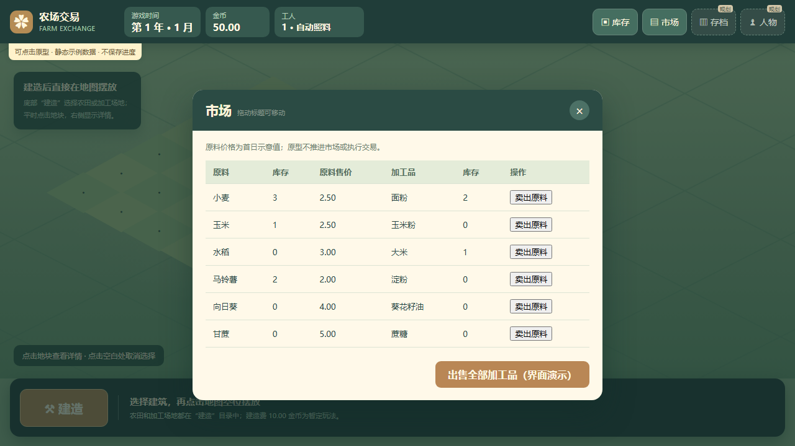
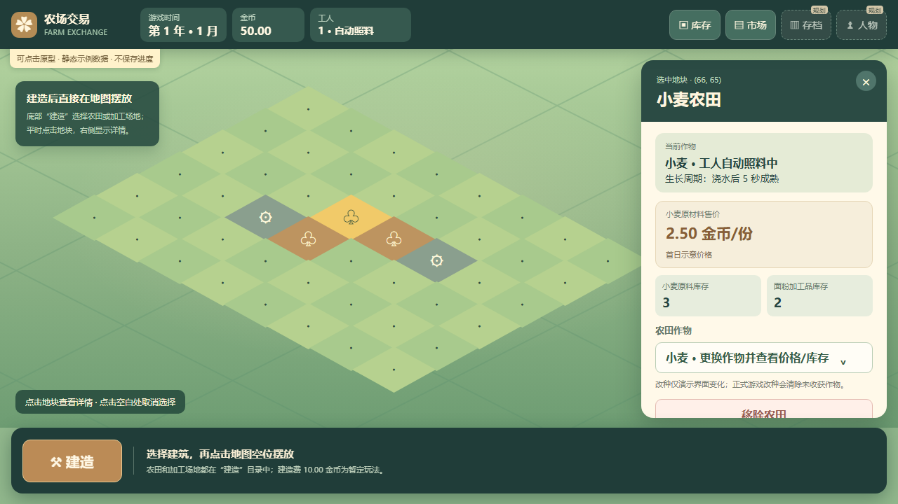
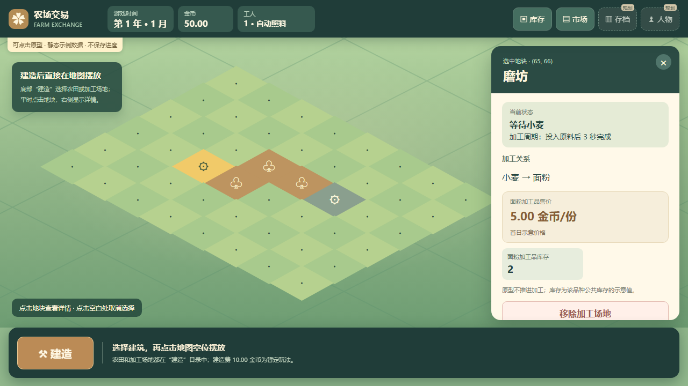

# 主界面目标接口与交互层级

本页记录 `scenes/main.tscn` 与 `scripts/ui/Main.cs` 的当前界面接口。正式样式依据为[像素田园主稿与实施范围](../../../project/ui-visual-prototype.md)；具体经营规则仍以 `docs/gameplay/` 为准。

[单文件 HTML 原型](prototype-main.html)用于查看界面层级和点击流程，仅演示视觉与交互；其中的原料价格是首日示意值，库存、交易和建造费不参与真实经营计算。下图为原型市场，实际 Godot 市场采用十四商品固定行、单一数量输入和独立消息滚动区，见[市场窗口接口](../market-window/interface-market-window.md)。

## 1080P 原型比例与倍率

正式设计和默认物理窗口使用 1920×1080。依据用户参考图按 1080 高度归一化，默认几何为品牌 277×93、日期 520×93、资源 373×107、近况宽 299、详情 409×727、底部操作栏 774×93。倍率位于日期卡；日期文字或字体倍率增加时，卡片按实际最小内容宽度重排并保持水平居中。顶部三个独立牌面、左侧近况、右侧设施和底部工具图标保留主稿的信息与留白比例；既有地图和人物素材继续使用。

项目关闭画布自动拉伸。扩大到 2560×1440 或 3840×2160 时，面板保留物理像素尺寸并通过原锚点靠边或居中，地图沿用镜头的“扩大视野、对象保留大小”策略。需要单独调整面板时，使用 [UiScaling 两倍率接口](../ui-scaling/interface-ui-scaling.md)：整体与字体默认为 1，各窗口或面板可分别设置，不增加设置菜单与存档。

品牌保留“田间 / FARM EXCHANGE”身份，两行日期显示真实日期及经营状态，暂停/继续用图标和 Tooltip 发出原命令；不恢复已删除的整组左侧标语。资源、近况、图标与详情预览都接入真实经营快照，不复制原型的固定示例日期、数量或进度。

右侧设施详情在固定 409×727 外框内复刻主稿的标题层级：84 像素标题栏、24 像素标题、12 像素英文分类和 22 像素关闭图标。普通管理窗口保留其既有标题尺寸；详情正文按真实快照重排，长内容可滚动。

## 玩家看到的层级

| 层级 | 内容与作用 |
| --- | --- |
| 顶部常驻状态 | 左上品牌、顶部居中“季 · 第 N 年 · N 月 · N 日”与暂停、右上金币与工人摘要，三个独立牌面之间留出地图。人数读取真实工人快照数量，开局显示“3 名工人”，副文本显示真实照料或暂停状态；金币主数值为可用金币，悬停可读总余额与冻结。暂停/继续控制经营时间；不显示未实现的存档和人物入口，不展示内部 `tick`。 |
| 地图 | 平时短按选择；农田／加工单次短按建造，道路短按起点、移动、短按终点整段提交，拆路为轴向投影直线。冲突／越界格标红；道路预览包括受影响旧路操作后的连接形状。拖镜头隐藏预览并保留道路段，松开不提交；界面与窗口外防穿透。 |
| 底部经营入口 | 居中木色操作栏保留 `BuildButton`、`InventoryButton`、`MarketButton`、`CultivationButton` 四个入口。一个“建造”入口打开目录，所有类型成功或失败都保持摆放，期间不弹详情。 |
| 左侧近况与反馈 | `FarmCountLabel`、`ProcessorCountLabel` 与 `ActivityLabel` 读取实际数量；`MessageLabel` 显示真实命令结果。设施 `BuildHint` 显示占地与预检；道路显示材质、起点／提交步骤，`BuildCost` 显示整段总价与可用金币，拆路显示实际道路格数与不退款。道路右键／Esc 二级取消，`CancelPlacementButton` 直接退出。 |
| 选中详情 | 仅在选中地块或建筑后出现；农田显示作物状态、获水后成熟所需天数、对应原料当前报价和公共原料库存，并提供改种入口。湿润空田显示待播种状态；不适季或剩余时间不足时显示播种等待原因。加工场地显示加工状态、从投入原料到完成所需天数、原料与产物关系、对应加工品当前报价和公共加工品库存。道路显式显示选路优先、速度不变及拆除不退款说明，并提供拆除按钮。 |
| 全局窗口 | 库存显示两类公共库存并逐作物编辑非负整数保留底线；市场负责已确认的交易命令。窗口不自行计算价格、费用或加工规则。 |
| 大小地图 | 左下小地图常驻全图；M 或展开按钮打开覆盖界面的大地图，M／Esc／返回关闭。大小地图读取真实土地及完整渲染视口，点击定位主镜头，大地图拖动只浏览底图。 |

加工场地目录按名称搜索并可滚动；新增建筑只增加目录条目，不增加底栏固定按钮。作物选择列表展示每种作物的适宜季节、生长周期、每轮产量、原料当前报价与公共原料库存，便于比较。市场显示十四商品当前/上次报价、实际涨跌与公共库存，选择商品后用一个数量输入买入、卖出或全售该商品；每种原料表行保留按品种全部出售快捷，底部保留出售全部加工品。报价日期与已公布真实因素/节日改期消息直接读取经营快照；无对应库存时全部出售按钮禁用。

## 二级及以下窗口的位置约定

**右侧选中详情也是二级窗口**，与建造目录、作物选择列表、库存窗口和市场窗口一样，标题栏可拖动。正文里的选择、滚动与操作按钮不触发拖动。

- 窗口第一次打开时使用预设位置：选中详情靠右，顶部 143 像素、右侧 31 像素；建造与其余经营窗口为居中浮窗，整体垂直中心上移 20 像素，随后限制在可用区域。
- 玩家拖动后，以该窗口的身份分别记录最后停留位置；关闭再打开同一窗口时回到该位置，切换所选地块时选中详情也沿用上一次位置。
- 窗口位置应保持在可见画面内；窗口尺寸或视窗变化时，要保证标题栏仍可抓取，底部建造按钮不被建造目录遮住。
- 打开窗口或拖动标题栏时，该窗口来到其他窗口前方；重新选中地图地块时详情来到前方，库存和市场窗口关闭。
- 建造目录打开期间，`RefreshDetail` 统一隐藏详情；暂停/恢复、经营及数值刷新遵守相同判断。目录关闭后原选择仍保留，下一次正常刷新恢复其详情及原位置；摆放、年度表和关闭详情沿原规则处理选择。
- 位置只属于界面状态，不进入 `FarmGame` 的经营状态。**仅在本次运行内保留**：关闭再打开保持位置，重启游戏恢复默认位置；不写入存档。

## 与经营模块的接口

`Main` 在主局准备完成时组装 `MapNavigation`（节点名同类型名），将真实 `FarmGame` 传给 `Initialize`；`OpenRequested`／`CloseRequested` 只提交开关意图，`NavigateRequested` 的地图本地世界像素交给 `CameraController.NavigateTo`。`Main` 每帧在镜头处理后，用 `WorldMap.GetGlobalTransformWithCanvas().AffineInverse()` 将实际可见视口中心及四角转换为地图本地位置，再通过 `UpdateCameraView` 更新视野框；固定复用四元素数组。经营的 `worldChanged` 刷新同时调用 `RefreshMap`，控件自己按真实空间快照判断是否重建底图，不因每秒生产刷新重复生成静态底图。

大地图开关不调用暂停接口、不停用主场景经营推进。M 仅接受无 Ctrl／Alt／Shift／Meta、非重复的按下，可编辑 `LineEdit`／`TextEdit` 焦点下不响应；准备未完成时没有地图入口，开发确认框实际可见时禁止打开。打开会取消建造候选与未完成道路段、结束窗口标题拖动及 Godot 原生年度条目拖放，保存并释放背景键盘焦点，保留窗口位置、可见性与编辑草稿。地图移至同级最前，全屏覆盖层接收鼠标，主场景消费展开期间的键盘，镜头以 `SetInputEnabled(false)` 同时阻止全局按键轮询；Esc 只关闭地图，右键不进入背景取消分支。关闭重新允许镜头输入并恢复仍有效、可见的原焦点，建造工具不恢复。

`Main` 组装窗口、唯一保留摆放类型与候选生命周期、普通所选格、分发玩家命令，并在命令或 tick 后统一刷新。农田／加工短按调用 `FarmGame.TryPlace`，成功读取实际扣费、失败显示真实原因，均保留模式、不弹详情。重新打开目录或年度表调用 `CancelPlacement()` 直接退出；右键／Esc 先经 `CancelCurrentSegmentOrPlacement()` 处理道路二级取消，按钮直接退出。Esc 在 `_Input` 接收，避免被焦点控件拦截。

道路 `Placement` 保存所选 `RoadMaterial`，内部 `RoadSegmentGesture` 在创建工具时固定新建/拆除模式，并维护当前起点、终点、真实轨迹轴与未起段鼠标候选，不持有正式道路。`CameraController.MapShortClicked` 第一短按设起点，第二短按调用 `TryPlaceRoads`／`TryRemoveRoads` 重验；原 `SelectionChanged` 在道路期间只清普通选择，避免双提交。仅 `MapPointerMoved` 的实际未按住地图移动可确定 L 顺序／拆路轴；帧刷新、原始 `_Input`、镜头释放、缩放和窗口更新只更新终点。未明确轴的双轴新建第二次点击给出明确提示并保留本段；直线和单格可提交。

道路预览把全路径（含冲突／越界）交给 `WorldMap.UpdateRoadPreview(cells, material, removing)`，由地图读取正式占用计算操作后拓扑；费用复用 `CheckRoadPlacement` 的宽整数总价，拆除数量只读统计实际道路。隐藏调用 `ClearRoadPreview`，保留未提交段；失败保留起点和顺序，成功或段取消清空本段但保留工具与材质，下一段重新选起点。直接退出清全部工具状态。UI不记录正式路段归属、铺设历史，不修改资金或土地，也不启用未确认辅助材质效果。

`RoadSegmentGesture.GetCandidate()` 一次返回当前 `Started`、`CanSubmit` 和候选格集合，地图预览、费用提示和正式提交准备均读取这份共同规则。新建和拆除未起段时均由该 Module 提供鼠标单格；已起段时提供原 L 形/投影直线及提交准备。拆除复用 `WorldMap.UpdateRoadPreview` 的正式道路过滤，只标记实际待拆道路，并刷新邻接断开后的形状，空格及其他设施不标记。`UpdateEndpoint` 只更新定位，`TrackPointer` 才可按真实移动锁轴，`ClearHover` 隐藏未起段候选且保留已起段轨迹，`Reset` 清当前段但保留工具模式。第一短按仍调用 `Begin`，候选查询不会设起点、提前锁轴或改资源。界面／拖动／离窗隐藏后清除表现；成功和段取消后重新按当前真实鼠标位置刷新单格，第一短按仍只锁定手势起点，不改变两次短按或投影规则。`TestRoadPlacement.CheckStartPreview` 通过真实主场景与既有显示查询验证五材质、前一格消失、旧路连接、占用、资金、隐藏／恢复、成功／取消与轨迹隔离，并比较正式空间快照引用、金币与库存；原新建修复的聚焦日志和第一点击前的1080P有效／占用截图保存于 `build/issue143-start-preview/`。#150 增加同一入口的拆路单格、空格／设施过滤及恢复回归，实际运行状态由本批次验收记录维护。

起点有效／占用截图均在任何准备性正式建造之前获取，占用来自开局农田实际子格，保持模型与UI同为50.00金币、0道路。随后旧路连接夹具经Main目录选择材质与真实两次短按准备，末尾经Main直线拆路工具清理，正常命令统一刷新金币与近况；清理后检查资源面板金额和道路计数与模型一致，避免后续目录截图继承直接修改经营夹具后的旧UI。

未占用地块的 `BuildingKind.None` 只说明没有建筑，不说明地形。`RefreshDetail` 在该分支读取本局 `Game.Terrain.IsFullLand(cell)`：完整陆地继续显示“空地”及原建造提示，池塘水面与岸边含水格统一显示“水域”和“不可建造”，说明只有完整陆地才允许建造。详情不保存地形副本、不复算岸线，也不改写经营模块的建筑占用语义。普通选择、经营刷新、暂停与恢复共用这次查询，农田、加工场地与道路仍使用各自的原详情和操作。

[#173](https://github.com/Fotally/Farm-Exchange/issues/173) 回归由 `tests/e2e/TestWaterDetails.cs` 在真实含水主场景中等待 `ReadyTask` 后完成：从同局权威地形寻找池塘内部、岸边含水和未占用完整陆地，通过 `WorldMap.SelectAtScreenPosition` 选择，反复切换并经过真实经营推进和暂停按钮刷新；另检查农田改种入口、加工投入产出说明、道路拆除及拆后空地详情。该检查已接入统一 `TestSuite`，独立场景为 `tests/e2e/test_water_details.tscn`。有窗口执行时以至少1920×1080保存修前与修后水面、修后岸边和陆地截图至 `build/issue173/`，headless执行检查相同详情行为。

`Main` 的当前 `Placement` 唯一持有候选 `BuildingOrientation`，每座候选从 `Q0` 开始。农田和加工摆放中的 R 与 `RotatePlacementButton` 共用内部旋转入口，按 `Q0→Q1→Q2→Q3→Q0` 更新候选并刷新预览，按钮显示当前 q。快捷键在 `_Input` 接收，但忽略重复按键、Ctrl/Alt/Meta 组合及 `LineEdit`/`TextEdit` 输入焦点，不截获文本编辑；道路与非摆放状态没有入口。近况面板使用主题次按钮把旋转和取消并排显示，整体/字体倍率仍由 `UiScaling` 管理。

预览和预检分别向 `WorldMap.UpdatePlacementPreview` 与 `FarmGame.CheckPlacement` 传同一个候选方向，实际建造向 `TryPlace(..., orientation: ...)` 提交该方向，UI不修改实例纹理或正式朝向。成功后当前类型保持、下一座方向重置 `Q0`；失败仍为当前候选，方向保留；取消丢弃候选，重新选类型从 `Q0` 开始。暂停不限制操作，旋转本身不推进经营或修改资源。实例正式朝向由土地模块保存，建成后详情不提供旋转命令；当前3×3占地与工作中心保持一致。

道路建拆成功后的统一刷新立即观察 `FarmGame.WaitForNavigationAsync`；准备期间 `AdvanceSimulation` 返回零，不把当前帧交给驱动、不累计等待时间。`ActivityLabel` 显示“正在更新道路，稍候继续经营。”，画面、镜头、窗口与道路输入继续响应，原倍率和暂停意图保持。驱动下一请求预算还检查导航就绪，防止经营检查点内建拆后继续消费同帧剩余时间；不改写 `SimulationDriver` 算法。`TestCoreLoop.CheckRoadCheckpointAsync` 从已有0.25秒进度请求8秒，在首个真实检查点分别建路与拆路，要求只完成1秒；准备时的大帧不消耗时间，恢复后0.5＋0.5秒只完成新的1秒，不重复消费旧进度或追赶被丢弃的帧余量。准备成功后继续原已领取行程，新任务使用最新道路成本。退出取消等待并释放局；技术失败明确显示原因、终结当前流程并释放局，禁用已结束局的输入，不继续旧导航。当前局开发流程启动也先等待同一就绪入口，不另设导航或经营时钟。

`Main._Process(delta)` 通过唯一 [SimulationDriver](../../time/simulation-driver/interface-simulation-driver.md) 推进完整经营。内部 `AdvanceSimulation(delta, checkpoint=null)` 也是场景测试使用的真实入口，不发出人工计时器信号；可选检查点在正式场景观察后执行，让真实主场景回归控制检查点中断。驱动在宿主观察前提交完整秒，`InvalidOperationException` 路径读取 `LastAdvanceTicks`，有已完成秒时刷新日期、库存、资金、生产和地图，并返回真实完成数；推进前拒绝返回零且保留旧小数。反馈区分“推进中断”与“推进被拒绝”，原日志去重保持。`SetProcess(false)` 停止主场景逐帧经营推进及预览、悬停费用刷新，`_Input` 等输入回调仍处理鼠标取消和摆放；`Game.SetPaused(true)` 只暂停经营，保留真实主场景帧。需要验证暂停中的界面自动刷新时，夹具应暂停经营并保持 `Main` 处理启用；`TestBuildPlacement.CheckFunds` 验证撤销冻结后悬停费用自动恢复，`CheckNativeInput` 验证拖动、镜头、缩放和离窗后的预览逐帧更新，并保留累计经营秒为0的断言。`SimulationRateButton` 位于日期卡，顺序为日期、`CalendarActionSeparator` 竖线、倍率、暂停；点击按1×→2×→0.5×→1×循环，开发高倍率显示实际值、点击回1×。按钮提交 `SimulationDriver.SetRate(..., Player)`，保留未完成tick；暂停时改速不恢复经营。倍率通知立即刷新显示与下一次点击提示，退出场景时解除订阅。暂停按钮立即同步工人真实位置；每帧经营后再显示最新人物，界面与地图统一刷新。

集中 `DEBUG` 组装区创建[DeveloperToolsWindow](../developer-tools-window/interface-developer-tools-window.md)和“开发测试”按钮；所有开发字段与调用均在同一编译条件内。当前流程只接入本驱动完整检查点和下一边界限额，独立对象由窗口用同一时间模块推进数据。公共经营不引用开发流程类型，发布保留公共速率入口。容量拒绝显示实际原因，不截断请求或改用其他倍率。

每帧在镜头处理后读取当前鼠标位置，检查窗口内状态、镜头拖动及可见界面矩形，使用 `WorldMap.ScreenToCell` 得到未裁剪的候选锚点并调用 `UpdatePlacementPreview`。界面遮挡检查递归穿过忽略鼠标的透明容器，遇到接收鼠标的面板只检查其自身矩形，不读取滚动区域外被裁切子项的矩形。透明 `TopBar` 容器忽略鼠标、仅三个真实顶部面板阻挡地图；间隙可继续操作地图。界面遮挡、离窗或拖动时清候选并调用 `ClearPlacementPreview`，不重同步生产地图块。整体原因复用 `FarmGame.CheckPlacement` 的现有顺序；空间逐格染色由地图读取实际占用，费用独立读取 `GetBuildingCostCents`，不能使用失败预检的零费用。摆放反馈每帧读取 `AvailableMoneyCents`，使经营、交易和冻结变化即时反映；预览不持有金币或生产状态，不推进经营，进入摆放保持暂停状态。

原始鼠标移动和左键松开也在 `_Input` 同步候选，沿用同一界面、窗口与拖动隐藏检查，避免同一帧的新位置尚未进入 `_Process` 就被提交。选择信号的经营提交入口再通过共用的 `SetPlacementCandidate` 同步释放格、地图覆盖、预检与费用，并将同一个释放格参数交给 `TryPlace` 重验，不从可空状态字段反读目标。回归用例在主场景挂树前订阅真实 `SelectionChanged`，先于经营回调观察候选与未扣费、未建状态；覆盖连续移动/松开和小于 8 像素跨格短按，验证提交前就已一致，不依赖建成后下一帧自愈。

左侧摆放提示和费用按明确换行排布，不进行逐字自动折行；预检原因独立一行，费用与取消按钮在其下方。端到端验收检查底部四入口及左侧近况控件的真实矩形均位于可见范围，逐行文字宽高足够，提示、费用与取消按钮纵向不重叠；有效、冲突、余额不足和窗口变化后均检查布局。

`TestBuildPlacement.CheckRotation` 通过真实 R 输入和按钮验证四次回原方向、输入框可输入 r、重复/组合键不旋转、暂停四向建造、失败保留及成功重置、新选类型与取消后重置；全部农田/七加工类型另验证首座提交 `Q1`、第二座自动 `Q0`，道路没有旋转入口。布局检查包含旋转按钮的真实文字宽高、面板范围以及与取消按钮和费用的间距。

`MessageLabel` 初始无消息时隐藏；所有消息写入共用内部 `SetMessage`，文字与可见性同时更新。暂停期间第一次取消摆放、无效交易数量与建造拒绝也立即可见，不等待下一次经营刷新或 tick。

放置端到端夹具在所有类型验收开始前将实际窗口设为 1920×1080 并等待尺寸更新，结束恢复原尺寸；headless 的默认物理窗口可能只有 64×64，不能只按 1920×1080 基准视口假定远离中心的目标格仍可见。候选断言始终检查真实悬停；镜头操作后以实际视口鼠标位置重新换算预期格，包含有窗口模式下整数鼠标像素的取整。

库存、市场和选种窗口只更新固定控件并发出操作意图；农田与加工详情分别读取 `FarmGame` 的语义快照，道路按 `BuildingKind.Road` 显式显示固定 [RoadDetailsPanel](../road-details-panel/interface-road-details-panel.md)，不对道路调用作物或加工详情查询。地图外观仅在影响地块或 tick 的命令后同步，交易只刷新经营窗口，不同步地图或直接启动加工。

库存的 `RawReserveRequested` 交给 `FarmGame.SetRawReserve`；成功后 `Main` 调用窗口确认输入并统一刷新，失败显示稳定原因。底线修改只刷新经营窗口，不同步地图、不启动加工。库存窗口的草稿、焦点与滚动由窗口自身维护。加工详情区分缺料、底线限制、待领取与进行中；底线编辑与生效规则见[原料加工](../../../gameplay/production/processing.md)。

`Main` 在地图下创建[WorkerPresentation](../../world/worker-presentation/interface-worker-presentation.md)，提供同一局 `FarmGame`、唯一时间驱动与地图变换；不为显示推进经营或接收到达回调。工人摘要标签为 `WorkerCountLabel`，从快照人数更新。暂停立即对齐真实位置并冻结动画，恢复不补现实时间；主地图和独立预览共用角色模块。

当前农田详情显示“生长周期：获得水后 N 天成熟”，加工详情显示“加工周期：投入原料后 N 天完成”。生产详情各显示自己负责的库存与售价，库存仍按品种共享；道路详情仅显示当前用途和拆除操作。主界面不计算建造费用、价格曲线或生产时间，也不暴露内部 `tick`。窗口实现见 [DraggableWindow](../draggable-window/interface-draggable-window.md)、[BuildCatalogWindow](../build-catalog-window/interface-build-catalog-window.md)、[CropSelectionWindow](../crop-selection-window/interface-crop-selection-window.md)、[InventoryWindow](../inventory-window/interface-inventory-window.md)、[MarketWindow](../market-window/interface-market-window.md)、[FarmDetailsPanel](../farm-details-panel/interface-farm-details-panel.md)、[ProcessorDetailsPanel](../processor-details-panel/interface-processor-details-panel.md)、[RoadDetailsPanel](../road-details-panel/interface-road-details-panel.md) 和 [UiElements](../ui-elements/interface-ui-elements.md)。

建造不要求土地解锁，生产设施费用为 10.00 金币。年月日和季节由 `GameCalendar` 给出；独立报价规则见[市场规则](../../../gameplay/trading/market-quotes.md)。详情、作物选择列表与市场均从 `FarmGame` 查询当前报价和公共库存，即时交易规则见[出售与价格](../../../gameplay/trading/sales.md)。

## 验收对应

加工详情回归的数量守恒以全场同作物口径核对：本区间实际收成＝公共原料＋公共成品＋所有同作物加工场地的真实在制锁量，包含随机赠送的加工场地，不能只计当前详情所选场地。`TestCoreLoop.RunProcessingSeedChecks` 明确覆盖种子0的单场地在制、种子8的其他同品种场地同时在制，随后仍运行原随机开局检查；两种子分别要求其他场地锁量为零和非零。UI成品数量、动态售价、市场出售与窗口断言继续保留，失败信息记录实际种子、收成、库存、逐场地锁量与UI值，不通过更换正常开局种子规避问题。

`tests/e2e/TestUiVisualLayout.cs` 以至少 1920×1080 验证真实挂树矩形、顶部面板、底部四入口、全部窗口避让上下常驻区、纸面次按钮全部字色与输入光标、实际实例近况更新。有窗口模式在 `build/issue94-validation/` 保存主画面、三种详情及各窗口截图供人工检查。地图和人物沿用原素材，不复制 HTML 原型的示例日期、库存或进度。

`tests/e2e/TestCoreLoop.cs` 覆盖目录选择、连续模式下成功保持及取消后查看详情、占用地块不扣费、两类建筑详情的状态、周期、售价与库存、春季甘蔗的不适季提示、窗口拖动、底栏避让、关闭重开位置、市场刷新后滚动与按钮身份，以及两类市场交易。`tests/e2e/TestBuildPlacement.cs` 对农田、七加工品种和道路验证成功继续、三种取消及冻结资金，并经原生输入分发验证短按、冲突、UI 与跨 UI 操作、左键拖动、缩放、键盘、窗口、离窗及暂停；有窗口运行保存 `build/issue87-validation/` 下的有效、冲突、边缘与镜头截图。`tests/integration/TestCameraInteraction.cs` 覆盖地图点击与镜头拖动的衔接。窗口只保存当前运行的节点位置，不写入存档。

道路端到端 `TestRoadPlacement` 覆盖五材质同价、两次短按、两种 L 顺序、未锁轴提示、原子冲突／冻结资金拒绝后调整、投影拆除、拖镜头、跨界面、离窗、二级取消与暂停；`TestCoreLoop` 保留每单格两次短按扣100分、固定详情及不退款拆除，分类与搜索仍保持控件身份。含道路的目录刷新夹具经 `RunRoadChecksAsync` 调用，真实等待道路导航就绪后再推进，继续核对暂停／经营刷新不重开详情、关闭目录恢复原选择类型和窗口位置。`TestUiVisualLayout` 同样在正式铺路后等待就绪，再验证原暂停文案和完整360秒生产布局，不跳过经营或降低断言。道路连接、分块缓存和预览由 `tests/integration/TestRoadMap.cs` 验证，经根 `TestSuite` 汇总。

`TestRoadPlacement` 在1920×1080真实窗口以 `(198,197)`→`(201,199)` 验证相同端点两种 L 顺序；每次地图短按和轨迹移动先检查实际可见视口与接收鼠标的可见 UI 矩形。原 `(201,202)` 终点落在底部工具栏内，正常防穿透会拒绝，因此不能拿该夹具判定经营整段失败。地图坐标须经当前镜头换算后仍无遮挡；跨界面按下／松开作为独立真实输入反例继续验收，不因修正地图夹具而放宽。测试只在图形后端保存 `build/issue143-review-fixes/evidence/` 下的六张道路截图（新建起点有效、起点占用、拆路起点预览、材质目录、L形与拆除预览），旧历史证据保留；headless 不请求画面读取，但执行相同截图前资源断言。

所有截图前核对实际可见可用金币、总余额／冻结提示，以及农田、加工场地和道路总数与经营模型一致。准备与清理道路通过既有目录选择和两次地图短按进入 Main 正式建拆流程，L形按两条正式投影直线拆除；暂停下仍即时同步 UI，不直接改模型后只同步地图，不新增外部 UI 刷新接口或伪造显示值。道路中文名称由 [UiElements](../ui-elements/interface-ui-elements.md) 提供，Main 仅协调工具和意图。拆路未选择起点时显示鼠标单格待拆预览，只标记真实道路并展示邻接断开；该候选不建立手势起点或拆除轴。

左侧 `ActivityLayout` 是忽略鼠标的纵向容器，保持原近况卡左上位置与299×389最小尺寸；`MessagePanel` 为第一子项，DEBUG开发入口左对齐放在下一项，基准间距8随统一整体倍率变化。道路提示、失败原因和字体变化使面板真实重排时，开发入口自动跟随下缘，不再用固定屏幕Y值遮挡操作文字；Release不创建该入口。道路有效L形和拆除预览分别在字体1／1.2／恢复1时检查提示、费用及取消按钮处于面板内，以及开发入口位于面板下方且在可见视口内。

图形夹具在五材质地图短按和原生输入前，先以 `Window.GrabFocus` 取得真实窗口焦点并等待两帧确认；再按当前视口变换真实移鼠到无遮挡地图点，等待两帧处理窗口事件，断言 `IsMouseInsideWindow` 已为真。`Input.WarpMouse` 相对当前聚焦的游戏窗口，仅检查坐标不能建立焦点与移入窗口的前提：窗口退出状态下直接调用镜头回调应继续被业务拒绝。该顺序只存在于测试driver，失败明确报错、不合成进入事件、不重试兜底、不改产品离窗判断；跨界面输入和显式窗口离开／进入的公开事件回归保持独立。

库存编辑用例还验证按钮与回车提交、非法文本拒绝、下一步领取和提高底线不退料，以及经营刷新、失焦、关闭重开时保留草稿、焦点、光标、滚动与控件身份。

市场数量意图由 Main 调用 FarmGame.Buy/Sell/SellCommodityAll；主界面与市场内反馈同时显示实际数量、金额或 TradeResult.ErrorMessage。七原料快捷与全部加工品快捷同样检查 SaleResult.Success，并显示容量不足等原因，不把拒绝当成交。金额格式接受 long，金币和库存经营容量仍为 int。输入非法时窗口不发出交易意图，Main 只同步输入错误消息。暂停允许主动交易；刷新不改数量草稿或商品选择。

从市场“委托与策略”打开 [TradeOrdersWindow](../trade-orders-window/interface-trade-orders-window.md)。Main 组装创建、同 ID 编辑、撤销、持续启停意图到 `FarmGame` 的真实命令，成功和拒绝交回窗口并统一刷新；不计算条件、手续费、保留线或冻结资源。委托命令只刷新经营窗口，不启动加工或重同步地图。每个未暂停 tick 在经营模块完成委托执行后，Main 刷新可见委托窗口；经营暂停只停止 tick，仍允许管理单据。Esc 优先关闭委托窗口，打开库存、市场、建造或选择地图时也关闭它，重新打开保留草稿和位置。顶栏主数值显示可用金币，悬停补充总余额和冻结；委托窗口明确区分总、可用和冻结资源，建造费用和实际可用资金仍由经营入口重验。

委托端到端验收由 `tests/e2e/TestTradeOrdersWindow.cs` 通过真实主场景完成，包含创建与同单编辑、条件分组、锁定现金基准、单次冻结撤销、持续启停、暂停编辑、真实成交费用、终态记录与市场可售按钮。窗口布局检查读取挂树后的真实矩形和滚动结果，不只检查构造尺寸。

市场端到端检查额外覆盖数量与资金/库存失败零修改、暂停交易、买卖两类商品、全售、报价变化后按执行时报价成交、草稿/焦点/光标/滚动与关闭重开，以及有真实十五行公告时窗口/消息/按钮与最后一行的可见布局。

`Main._Ready` 用同一地图换算将镜头定位到分数中心 `(191.5,191.5)`。建造目录标明当前生产设施3×3、道路1×1；摆放提示从占地属性动态计数。任意空小格可作生产设施锚点。`Main` 保留实际点击小格，详情标题通过 `GetBuildingSpace` 显示唯一锚点及占用格数；改种、农田/加工详情和拆除全部将该小格交给经营入口解析整座实例，不自行遍历九份状态。地图同步仍只在改变地块外观的命令和经营tick之后执行，库存/市场/只读详情刷新不全图重同步。

`TestCoreLoop.CheckFootprintUi` 验证真实主场景中心五座免费3×3布局、各田中央工人出生、九子格同详情、非三格对齐锚点一次扣费、子格改种与末端子格拆整座。坐标/输入测试迁移到新中心与四边；生产负载按16,384实例和147,456占用子格分别验收，避免把小格数量作为实体数量。

## 季节耕作表连接

`Main` 从开局底部 `CultivationButton` 和农田 `FarmCultivationButton` 打开共享年度表；接收保存、批量应用和整表删除意图，调用 `FarmGame` 的同名计划命令并展示真实结果。每秒可见窗口刷新不覆盖编辑草稿；Esc 关闭年度表。

整表删除意图 `DeleteRequested(id)` 只交给 `FarmGame.DeleteCultivationPlan(id)`；将成功或中文拒绝原因交回窗口 `ShowDeleteResult`，并即时同步主界面消息、共享表列表、编辑器和详情。删除已引用表时，由经营模块解除其全部农田引用，保留当前作物轮次与水分，各田随后按当前作物自动复种。UI不自行删除配置或逐田修改；不存在的编号正常拒绝。此命令不改变当前地块的作物种类或生长阶段，因此不重建地图外观，也不推进经营 tick。

共享表保存成功后同步地图，包括暂停时由表编辑改变空田当期作物的情况，不等待下一经营步。移除选中农田成功时先关闭依赖该田的作物选择窗口，再刷新详情和其他窗口；立即改种与预备下一轮都遵守此生命周期。

农田两个手动按钮分别组装作物窗口模式。立即改种继续调用 `SetFarmCrop`，预备下一轮调用 `PrepareFarmCrop`；窗口选种前告知清空本田安排和立即改种损失。农田详情独立显示实际进度与计划引用。窗口与经营的约定见[耕作表窗口接口](../cultivation-window/interface-cultivation-window.md)。

## 日志帧观察

Main._Process 在场景就绪后唯一调用 RuntimeLog.ProcessFrame，主局与独立局共用一次进程帧采样，暂停仍轮询诊断现实预算。帧末传实际窗口、视口、玩家倍率、地图本地镜头中心及已绘制缓存累计给日志模块，稳定帧不输出 ViewChanged。摆放预览、农田详情和选种预检均保持纯查询，不因每帧刷新输出 RuleChecked。DEBUG 内部 LoggingFactory/InitialSeed 供 1080P 专项验收父节点在 _EnterTree 设置；必须早于 Main._Ready 开始初始化，结束清空，不进入发布接口。

`CreateGameAsync` 在 DEBUG 下优先使用已设置的 `LoggingFactory`；未设置时进入公共平台选择块，编辑器与 Windows 使用文件日志，其他平台关闭输出。Release 直接执行同一平台选择块。工厂分支与公共块使用显式花括号，避免条件编译分隔 `else if` 时不同 SDK 格式器产生不同缩进。`InitializeSceneAsync` 等待创建结果后组装场景，完整任务由 `ReadyTask` 暴露；工厂或初始化异常使该任务失败，等待它的调用方可观察原异常。`_Ready` 捕获失败：场景仍在树中时通过已创建的日志记录初始化失败并释放日志，显示“地图准备失败”及原因，并向 Godot 输出异常；已进入退出流程则不更新场景。日志工厂本身失败时尚无日志实例，仍显示并输出错误。

`TestCoreLoop` 通过正式目录、暂停按钮和推进入口验证空地、农田、加工与道路详情在目录后持续隐藏、关闭后原选择及位置恢复；另通过完整检查点控制异常，检查真实完成数、资金/库存显示及随后半秒不会重复消费。`TestRoadPlacement.CheckGesture` 从集中后的候选查询验证首次单格、清除悬停、实际轨迹、定位不锁轴及拆路清段模式保持，原生输入 E2E 继续验证成功/失败/取消的工具生命周期。

#110 开发验收可在具体 `Main` 实例入树前，或其父节点 `_EnterTree` 中、首次 Game／Driver 查询前设置 `InitialTerrainRules`。它是 DEBUG 下的实例配置输入，默认 null 走正式含水配置加载；不存在可变全局地形配置、无水测试开关或失败后的替代地图。既有满图场景显式传入经正式契约验证的纯陆地配置，各实例相互隔离，Release 不编译该入口。

## 含水新局准备顺序

含水新局由 `FarmGame.CreateAsync(SceneTree, …)` 完整生成并等待 Godot 导航就绪。`Main` 在此期间只显示“正在准备地图…”，停止镜头输入，不创建可操作的经营界面，也不推进经营秒或驱动余数。成功后一次组装地图、人物、界面和唯一时间驱动；导航准备所需物理帧不计入经营。准备失败明确显示原因，不改成无水局。退树会取消尚未完成的准备，释放局与日志，不把迟到结果挂回场景。

`ReadyTask` 供场景验收在 AddChild 后等待完整就绪，未就绪访问 Game／Driver 明确拒绝。DEBUG 下显式合法纯陆地 `InitialTerrainRules` 保留同步快速就绪，旧纯陆地夹具的入树调用顺序不变；默认 null 仍创建真实含水局。新含水表现测试直接等待工厂，真实 Main/FPS 验收等待 ReadyTask，且断言准备期间经营秒为零。

目录持续遮挡详情与检查点异常恢复的主场景回归，也在实例入树前显式配置纯陆地；它们仍经正式 Main 与时间驱动验证新合入行为，不把导航准备等待混入原经营断言。正式选框与候选的共用外围几何测试保留，并在显式纯陆地上检验越界与真实占用。

开发流程的独立含水局也等待同一完整工厂。`TestDeveloperToolsWindow` 在点击运行后先核对真实准备提示、启动锁定与中止可用，再等待该窗口实际 `PreparationTask`；后续推进、报告和宿主退出断言只在准备完成后进行。`TestDeveloperFlowEditor` 同样等待当前启动任务，避免把尚未创建的独立局当作已开始经营。

## 拆路初始预览实景

以下为 1920×1080 真实主场景：尚未锁定拆路起点时，鼠标所在道路显示红色待拆标记，邻路显示断开后的形状；场地和库存不受预览影响。完整运行结果见 #150。

