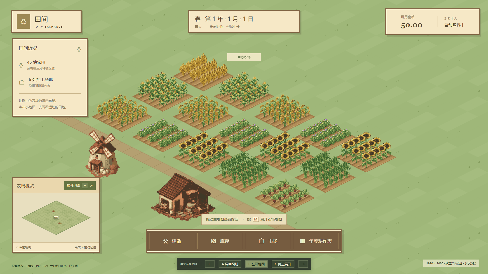
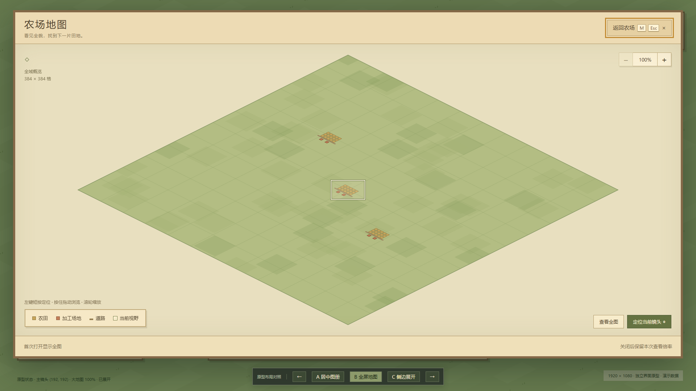

# 大小地图 1080P 交互原型

关联 [#153](https://github.com/Fotally/Farm-Exchange/issues/153)。这是用于确认界面和操作的临时 HTML 原型；当前 B 全屏方向、无区域标签与左拖浏览作为正式接入的设计基线。完整实施规则见[大小地图规划](../../../project/map-navigation-proposal.md)，来源见[地图调研](../../../research/minimap-navigation.md)，键位见[键鼠登记](../../../project/input-bindings.md)。正式功能已接入，运行验收见关联议题；本页浏览器记录仅证明原型行为。

## 打开

双击 [prototype-maps.html](prototype-maps.html)，或从项目根目录执行：

```powershell
Start-Process './docs/architecture/ui/main/prototype-maps.html'
```

无需服务器、安装依赖或联网，图片从仓库 `assets/gameplay/` 读取；请保留 HTML 在仓库中的相对位置。浏览器缩放设为 100%，使用 1920×1080 内容区可按设计原尺寸查看；较小内容区等比缩小整个演示画板，较大内容区居中保持原尺寸。这是原型展示方式，不修改游戏的 UI 倍率规则。

## 三种布局

| 方案 | 大地图排版 | 供比较的问题 |
| --- | --- | --- |
| A 居中图册 | 1460×804 居中木框，地图与右侧说明分栏 | 暂留作布局对照 |
| B 全屏地图（默认方向） | 1848×962，地图为主体，图例浮在左下 | 已采用全屏方向，预留原型工具条和外围留白 |
| C 侧边展开 | 1128×958 靠右，坐标与图例置底 | 保留左侧主画面能否帮助导航 |

底部深色原型工具条切换 A／B／C；URL 的 `?variant=A`、`?variant=B`、`?variant=C` 可保留所选布局。左右方向键仅在本原型中切换方案，未登记为正式游戏快捷键。切换布局不清空镜头与大地图倍率状态。

## 可操作路径

- 小地图保持全图；左键点击或按住拖动移动主镜头，浅色视野框与背景农场同步更新，单击不展开。
- M 或小地图旁按钮打开大地图；首次显示全图，M／Esc／返回按钮关闭。长按 M 不连续开关。
- 大地图左键短按定位主镜头，保持窗口打开；按住左键拖动仅平移大地图底图，松开不定位，原有右键拖动保留为辅助操作；滚轮只缩放大地图。放大后可用加减、全图、定位当前镜头按钮。
- 原型用 8 个画板像素区分短按与拖动；一旦进入拖动，即使移回按下点再松开也不会定位主镜头。
- 同一页面会话中关闭重开大地图保留倍率和查看中心；刷新网页重置。正式计划已确认本局内保存倍率与查看位置、新开一局重置；本原型没有正式新局入口，网页刷新不代替新局验收。
- 主画面左键／中键拖动平移、WASD 按键移动、滚轮在 1.25～2 倍间缩放。大地图显示时阻止这些背景操作。
- 底部建造、库存、市场等仅作为布局背景，不执行经营。正式计划已确认打开大地图不暂停经营，开关地图不改变既有暂停状态；原型没有生产推进或暂停模拟，不能据此验收该规则。

## 原型假设与边界

- 暂用与主地图同向的等距菱形，小地图为 348 像素宽；最终投影与尺寸尚待确认。
- 大地图以适配全图为 100%，演示范围为 100%～1200%；滚轮围绕鼠标位置缩放，加减按钮围绕面板中心缩放，回到 100% 时重新居中全图。上述步长与上限均为原型假设。
- 演示地图含三片区域、45 块农田、6 处加工场地和短路段，用于测试远距离定位；大地图不显示区域名称及其底色标签。主场景的示例区域提示保留，不代表正式区域管理功能。地图颜色斑块是示意背景，不代表新增地形。
- 底层作物、土壤和建筑使用项目现有清亮 v2 静态图片；底图、图例和主镜头范围由浏览器绘制。它们只读固定演示数据，不读取正式游戏，也不形成第二份正式经营状态。
- 小地图／大地图画布是该次鼠标拖动的接收者，松开、失焦、关闭大地图会结束拖动。原型没有实际建造工具和输入框，不能代替正式 #136 焦点修复或建造输入集成验收。
- 当前功能设计方向已暂定，原型参数与未定边界由规划页继续跟踪；不会将原型代码直接移入正式游戏。

## 浏览器检查

2026-10-12 使用 Chromium 在 1920×1080 内容区完成：图片加载、小地图点击拖动、M 首次全图、滚轮与右拖独立于主镜头、Esc 关闭后恢复查看状态、大地图点击后保持打开、M 重复按键忽略和三布局切换。另检查 1280×720 的等比预览，主要验收仍为 1080P。浏览器未报告页面脚本错误或资源请求失败。

检查报告及布局／缩放截图保存在本地 `build/issue153-prototype/`。这不是 Godot 性能、正式输入或构建验收。

同日按反馈修订为 B 全屏默认预览，移除大地图区域标签，增加左拖浏览；复验覆盖左拖不会改变主镜头、移回起点释放不会误定位、短按定位、缩放后左拖与关闭重开记忆。修订证据为 `build/issue153-prototype/left-drag-check.json`。




