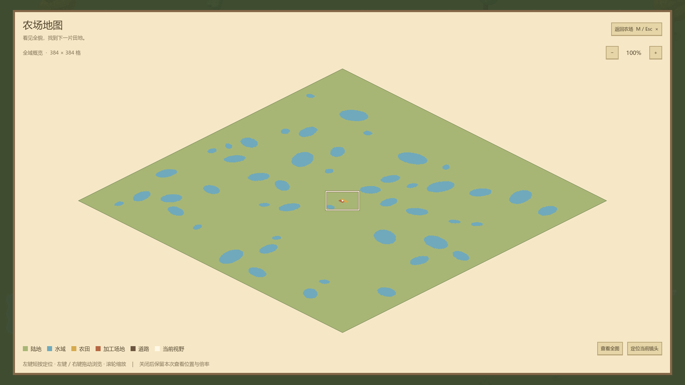
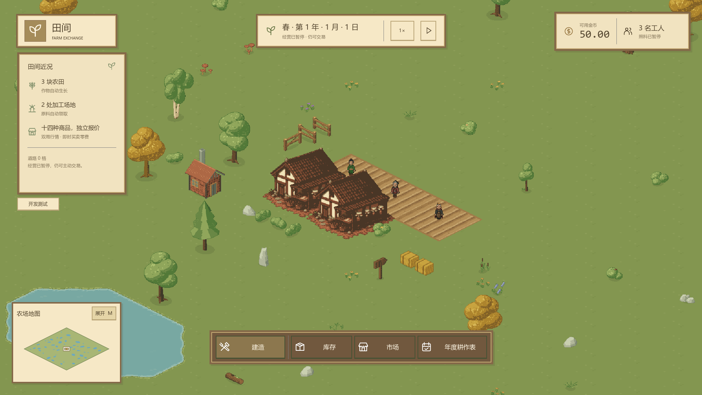

# 大小地图导航 Interface

关联 [#153](https://github.com/Fotally/Farm-Exchange/issues/153)，视觉依据为 [B 全屏原型](../main/prototype-maps.md)，实施范围见[大小地图规划](../../../project/map-navigation-proposal.md)。

`MapNavigation` 是地图导航 Module。它唯一维护本局大地图浏览中心、倍率、鼠标手势和地图绘制缓存；经营局、地形、占用与主镜头仍由原模块拥有。大地图不推进或暂停经营，不处理键盘开关，也不清理建造工具。

| Interface | 调用约定 |
| --- | --- |
| `Initialize(FarmGame)` | 控件进入场景树后绑定已准备完成的真实局，读取地形并重置大图到全图、关闭展开态；同局普通刷新不得重复调用 |
| `IsExpanded` / `SetExpanded(bool)` | 宿主通过优先级检查后应用开关；切换取消当前鼠标手势，不触发定位；关闭保留本局中心与倍率 |
| `OpenRequested` / `CloseRequested` | 展开和返回按钮只通知意图，主场景负责编辑焦点、确认框、背景输入隔离和工具取消 |
| `NavigateRequested(Vector2)` | 参数为真实地图本地坐标；小图点击／拖动、大图左键短按共用，主镜头仍执行边界限制；大图定位后保持打开 |
| `UpdateCameraView(center, corners)` | 宿主在主镜头更新后提交地图本地中心和完整渲染视口的四个周向角点；内部复制，调用方可复用数组；四角数量不为四时明确拒绝 |
| `RefreshMap()` | 读取 `GetBuildingSpaces()` 的稳定只读快照；引用未变时不重建地图设施，不读取建造预览 |

主场景将本控件置于普通窗口之上。根控件忽略鼠标，常驻小地图与展开覆盖层接收鼠标；宿主负责展开期间的键盘隔离以及 M／Esc 路由。控件在窗口离开、窗口失焦、关闭地图和重新绑定时取消手势。退出场景解除窗口及倍率通知并释放绘图资源。

## 浏览与鼠标归属

小地图固定全图，左键按下即定位，按住移动持续定位，吞掉滚轮。大地图滚轮以指针为锚点，每次乘／除 1.25，倍率限制 1～12；加减按钮以视图中心为锚点。“查看全图”复位中心与 1 倍，“定位当前镜头”仅移动大地图中心。

大地图左键短按仅在释放时通知定位，位移达到 8 个逻辑视口像素后锁定为拖动；拖回原点仍为拖动。右键使用同一拖动逻辑但永不短按定位。已开始的手势由原始输入捕获，跨出控件后继续到松开。菱形外按下和定位被忽略，拖动浏览中心通过现有地图坐标限制保持在地图内。

## 绘制与缓存

内部 `MapNavigationDrawing` 从 `Terrain.GetCell` 的真实组合编码读取现有 `water_81.png` 水 mask。每格 2×2 采样生成本局一次性纹理，以同一 `MapCoordinates` 等距基向量显示；岸格不按“不能建造”整体涂成水。陆地与水域颜色固定，首版不读取天气或工人。

设施来自真实空间快照，按工作中心和真实 3×3／1×1 大小批量生成 mesh；农田、加工场地和道路使用不同颜色，缩小到全图后有最小屏幕标记保证可辨。最小标记仅是绘图强调，不修改真实占地。两个视图共用地形纹理与空间快照，各自拥有适合本视图倍率的设施 mesh。

`MapNavigationCanvas` 将底图与设施放在缓存绘图节点中。平移只移动节点，缩放／布局尺寸变化才重新生成最小标记的 mesh；空间快照变化才刷新设施。视野框独立重绘，不在镜头移动时扫描地形或设施，不每帧重建密集地图。

## 排版与验收

默认以 1920×1080 排版：左下角木框小地图，展开为覆盖整个游戏界面的木框纸面地图；无区域名称或模拟设施。标题、按钮、图例和操作说明用正常容器及统一主题，字体倍率触发容器重排；底栏左侧图例按完整词组换行，不拆成逐字竖排，右侧辅助按钮保留自身高度并垂直居中。底图和视野框读取 `UiScaling` 整体倍率，窗口扩大保留控件像素倍率并增加地图可用区域。

真实输入测试应覆盖菱形边缘、缩放锚点、拖回起点、跨控件释放、离窗／失焦取消、重开记忆与新局重置；主场景测试另核对编辑焦点和确认框优先级、建造取消、暂停保持和真实镜头四角。密集地图须通过仓库完整覆盖率、1080P 图形性能与导出启动验收，不能用原型截图替代。

以下为 1920×1080 真实含水主场景的地图表现；完整输入、倍率和建拆截图保存在本地 `build/issue153-validation/navigation/`，交付验收状态以关联议题为准。

