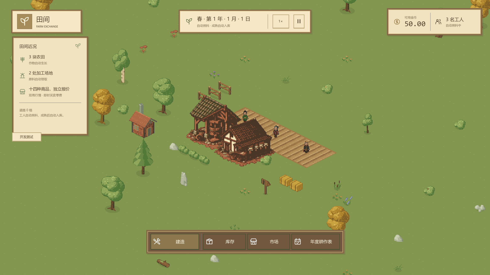

# WorldMap 分块缓存与静态资源实现

对应[WorldMap 对外接口](interface-world-map.md)。空间权威仍属于 LandOccupancy/BuildingFootprint，生产状态仍由 FarmingSystem/ProcessingSystem 拥有；WorldMap 只保留从快照得到的绘制缓存，不推进经营。

## 地面与实例缓存

地面仍按8×8基础格组成48×48块，地表采用清亮v2三元mesh图集，从本局地形读取81组合编码；稳定格坐标选择变体0～2。每块缓存带UV的ArrayMesh与道路材质/mask/稳定变体及临时状态，五张原图集的AtlasTexture覆盖草地。道路变更只重绘受影响可见块，屏幕外脏块进入视野时重绘。镜头只改变可见性，农田或加工外观不重建草地。连接及操作完成后预览见[道路实现](implementation-road-appearance.md)。

`SyncFromGame`按稳定空间快照每生产实例读取一次`GetPlot`。实例外观键为建筑类别、作物类别、作物阶段、湿润、三档索引和实例朝向；不把每秒变化的精确进度加入键。`GrowthProgress`由经营入口以精确时间单位计算，三档是`[0,1/3)`、`[1/3,2/3)`、`[2/3,1)`。Seeded显示通用种子，None无作物，Growing选择对应七作物之一。改种或同种重启、自动收获、换季清理均按新快照撤掉旧层；拆除立即释放土层/表层节点，同锚点重建使用当前类别与作物。

地图仅缓存上次完成空间同步的只读快照引用。`LandOccupancy` 在建造、移除与清空后失效该快照；引用未变时，不重建道路快照投影、不构造设施删除 `HashSet`、不扫描环境完整占地。引用改变时按新旧道路差异刷新格和四邻涉及块，不以数量相等判断占地相等；首次初始化也执行完整空间同步。离屏脏地面块仍由镜头可见性更新时重绘。

空间同步将经营局的建筑布局投影为地图绘制缓存：新增实例创建土层／设施节点，删除实例释放旧节点，道路占用更新地面块，新增完整占地永久清除其中环境装饰根点。它不会推进农田、计算产量或更新土地权威状态。多数经营秒没有建拆，因此这些工作可以跳过，而农田水分、作物档位与加工外观仍在下述动态刷新中更新。

`ReferenceEquals` 判断依赖明确的[土地生产者约定](../../land/land-occupancy/interface-land-occupancy.md)：占地未变化复用同一不可变列表，成功建拆后发布新列表，已返回对象不被改写；`FarmGame.GetBuildingSpaces` 原样转发。不能每次查询复制列表，也不能原地修改列表后保留引用。前者导致重复空间同步及性能回退，后者导致漏掉建拆；同数量同锚点更换类别／朝向也必须发布新快照。`TestLandOccupancy` 保护生产者稳定性，`TestFarmGame` 保护经营转发，既有 `TestRoadMap` 保护消费者对同数量变更的响应。

所有生产实例的 `GetPlot`、外观比较、`Processing` 状态与 `Snapshot` 更新仍逐次执行；`UpdateFacilityVisibility` 和可见实例的 `Motion.Configure` 保留，真实成功结果仍按原凭据重验。土层的 `_visible` 与表层的 `_surfaceVisible` 是既有节点显隐缓存，避免不变时反复写Godot属性；表层由是否使用q0局部动效独立决定，不能随土层直接打开。该优化不改变主场景的推进／刷新时机、不延后生产外观，也不新增经营或占地权威状态。

加工动效直接复用该次 `GetPlot` 中的 `Building == Processor && RemainingSeconds > 0`。经营详情的加工中状态也由同一加工快照的正剩余时间判定；地图仅需要启停，不再重复读取完整详情的作物、报价涨跌、库存与待料说明。开始、完工与完工后同秒续批仍按最新完整经营快照同步，未减少动态实例刷新。`TestWeatherPresentation` 经真实买入原料、领取启动及批次完成，对照 `GetProcessorDetails` 状态与 `GetPlot` 剩余时间验证磨坊等待不转、加工旋转、完成待料停止。

资源映射、q0～q3路径、pivot、外观键和节点缓存均为WorldMap内部实现，不把纹理路径或字典暴露给场景协调入口。七建筑、两土层、播种和七作物三档均提取四向，共124张原字节PNG，另保留一个地形图集。加载时使用固定四向数组，土层、播种层与生长档都按同一个快照朝向索引；不动态扫描目录，不旋转整图。来源见各`assets/gameplay/{terrain,soil,crops,buildings}/source_notes.md`与[素材总览](../../../project/asset-sources.md)。

## 占地外围几何

外围计算继续集中在现有内部 `PlacementPreviewGeometry`，不增加转发模块。`GetCellOuterEdges(anchorCell, offset, offsets)` 按同一四邻顺序检查完整占地偏移集合，只返回没有相邻占地格的边，角点由 `MapCoordinates.GridRectangleOutline` 转换为地图本地坐标；它不读节点、颜色、线宽或缓存，也不将越界候选移位或裁切。实际固定形状仍唯一来自 `BuildingFootprint`，几何模块没有新增建筑配置。

`SelectionOverlay` 通过 `FarmGame.GetBuildingSpace(selectedCell)` 解析任一子格的同一锚点／占地后，逐格调用此方法，以既有3像素金线绘制整座外围。空格选择继续绘制原有单格线框。`PlacementOverlay` 从当前候选同一占地定义逐格调用此方法，仍先画半透明设施图与逐格冲突覆盖，再以2像素绿／红线绘制对应格的外围边；内部逐格的1像素提示线保持。两个调用方各自建立一次偏移集合并保留自身重绘时机，相同候选的缓存判断不变。

共享边计算只在独立交互覆盖层绘制，不调用 `SyncFromGame` 或地面块重绘。`TestWorldMap` 以3×3、1×1和既有2×4矩形夹具检查唯一外围线段及越界原位置，`TestRoadMap` 逐子格核对真实整座金框和未改变的内部边像素，`TestPlacementPreview` 核对三类型及冲突／越界候选的逐段外围颜色；后两者同时保护 `ChunkRedrawCount` 不增加的约定。

## 统一层级

从后至前依次为：

1. 地表/道路分块（Z=-2）。
2. 农田干湿土（Z=-1）。土层永远不会盖住人物脚根。
3. 共同YSort层（Z=0）：建筑、通用播种及四种静态整田作物以工作中心为节点原点，q0小麦/甘蔗/萝卜各独立植株以根点为节点原点，人物以脚根为节点原点，Y较大者后画。人物容器也启用YSort，使各人物跨容器参与排序；同Y按场景节点顺序稳定排列。
4. 地图边缘与整设施金色选框（Z=10）。
5. 候选朝向的设施半透明图、逐格冲突覆盖/外围线与锚点环（Z=11）。候选属于交互提示，置于真实设施前方，不参与世界遮挡；先画候选图再画冲突覆盖，不能让屋顶遮掉红格。

建筑画布256×240/pivot(128,176)，农田224×192/pivot(112,128)，均保留原透明边并对齐`WorkCell`；逻辑3×3占地不由PNG大小推断。玉米、水稻、马铃薯、向日葵仍按静态整田工作中心排序，不裁切原图；q0小麦、甘蔗、萝卜采用原包独立植株，每株原点为根点，经两层嵌套YSort参与同一世界排序。q1～q3全部采用各方向完整静态原图，按设施工作中心排序；q0磨坊body→sails→hub在单个建筑内部保持局部顺序，不能将叶片抬为全场高Z。

## 跨块与视野边缘

设施静态层作为独立Sprite2D、实际动效作为同级FacilityMotion绘制，不隶属锚点地面块，不按8×8块裁剪。可见性使用保留的整幅画布矩形；工作中心已经离开视口但屋顶仍与视口相交时仍显示。镜头变化只检查块与实例可见性，不读取或推进生产。工人不受地图块开关影响。选框按真实占地外边单独绘制，任一子格仍操作同一实例。

## 验收

`TestWorldArt.RunChecksAsync`经真实经营命令得到七作物待水、湿润与三个实际生长档，并从真实Godot视口取样与四种静态作物/五种静态建筑PNG不透明像素比较；两种动态建筑另核对拆分底图下墙，九个动态作物档位由TestFacilityMotion验收真实根部像素与冻结；同种重启检验撤图留水，拆除与同锚点重建检验旧图清理。真实NpcCharacter经`AttachDepthSorted`嵌套容器挂入，分别站在建筑工作中心之前/之后，比较人物与墙面不透明交叠像素；屋顶边缘检查根点离屏仍保留画布。独立场景`tests/integration/test_world_art.tscn`以1920×1080运行，截图保存`coverage/world-art-*.png`、`world-depth-*.png`与`world-roof-edge.png`。headless验证真实状态流与加载，像素断言仅由有窗口渲染执行，不能将headless当作图形验收。

`TestRoadMap`保留道路跨块、九子格选择、完整选框、改种和整体拆除，并用真实土层/建筑纹理替代旧彩点断言。相邻屋顶可能遮住农田右侧，因此土层采样取左侧无遮挡区；九子格占用仍全部核对。`TestPlacementPreview`保留三种候选、局部冲突、越界、取消和镜头输入检查。

`TestRoadMap`另覆盖同数量道路在一次同步前拆建到不同格、同数量生产设施在同一锚点由加工建筑替换为q1农田，验证稳定快照引用变化后撤销旧层并显示新朝向。既有 `TestWorldArt` 与 `TestFacilityOrientations` 在占地不变时验证真实播种、供水湿土、生长三档与局部动效；`TestEnvironmentDecorations` 验证新占地才永久清除根点、失败／预览不清、拆除不复生；地图屋顶边缘和共同深度排序继续使用原图形断言。

`TestWaterFps` 追加含水局的真实道路偏好图形检查，仍通过土地稳定快照触发可见道路块刷新。固定 17 格 U 路跨过 x=192 的缓存块边界，起点(190,190)、目标农田工作中心(202,190)，道路上沿位于 y=187；同端点原生路线应因道路成本形成可见绕行，拆路同步后恢复直达。人物来自正式 `WorkerPresentation`，实际经营推进产生行程与节点位移；用例不绘制代替人物的路线，也不修改地图缓存模拟建拆。逐阶段路线、真实移动、扣费与出售事实和四张对照截图保存到水域验收目录。2026-10-14 保留新合入修复后的组合已重新通过该道路用例及后续四倍率负载；真实工人按每经营秒 3 格沿路前进，拆路后同端点恢复直线，目标田实际产出并出售小麦支付后续建田费。具体运行数据见[接口验收入口](interface-world-map.md#验收入口)。

满地图仍为16,384生产实例、147,456占用小格，性能门槛与镜头轨迹见[构建与验收](../../../project/build-and-validation.md)。性能优化仅影响绘制，不延后经营。预览性能场景的`--placement-preview`参数继续使用相同负载与FPS/P95门槛。

现有 `TestRoadFps` 保留 45 格五材质跨块交叉路、连续新建／拆除预览、真实 UI 不变及平均 60 FPS／P95 16.67 ms 门槛。准备流程先等待 Main 就绪，停止宿主自动推进，真实批量建路后等待 `FarmGame.WaitForNavigationAsync`，再切换暂停并开始原两秒预热、八秒采样；导航准备帧不计入绘制负载。该适配未改路景、费用或采样窗口；2026-10-14 保留新合入修复后的组合已重新通过正式有窗口运行，实际退出码与最新测量见[接口验收入口](interface-world-map.md#验收入口)，过程记录为 `build/issue110-road-preference/merged-final-road-fps.process.json`。

WorldMap只为视口与完整画布相交的实例创建FacilityMotion，离屏释放局部节点；经营快照缓存继续保留，重新入屏按当前状态创建而不积压历史结果。含蒸汽的保守可见矩形相对工作中心为(-128,-208)、尺寸256×272，原图pivot不变。每帧只推进可见列表，公共倍率跟随Driver，高开发倍率视觉1×，暂停零推进；结果消费/原实例有效性约定见接口。地图同步及镜头变动重算可见列表，不为全图16,384实例展开数十万植株节点。

## 真实图形证据

以下图像以指定 Godot 4.7.2 Mono 在 1920×1080 下渲染；主场景使用玩家默认1.25倍率，独立遮挡夹具使用1倍以逐像素核对。完整测试、覆盖率和性能数据见[验收记录](../../../archive/project/testing.md#2026-10-07-105-清亮-v2-首批素材动作动效与环境验收)。

[人物在建筑前](godot-bright-depth-front.png)与[人物在建筑后](godot-bright-depth-behind.png)使用同一地图排序接口及真实角色图，测试实际不透明重叠像素；[局部动效专项画面](godot-bright-motion-stages.png)对应两建筑和三作物固定根检查，不是素材包示例工程。

内部EnvironmentDecorations一次生成固定视觉布局，WorldMap每次真实占地同步删除其中的根点。剩余记录与按画布可见懒建的Sprite分开，离屏释放Sprite不影响已清除事实；环境Sprite与建筑、作物、人物共用实体层。环境种子、人工点与密度见[环境实现](implementation-environment-decoration.md)。

图形诊断保留了两个夹具修正证据：稀疏播种层5像素步长仅命中9个不透明点，改用2像素步长，仍维持至少10点和原色差门槛；选框会正确盖住相邻屋顶，因此原图检查清除选框，下一帧重新选中检查金框，不把金框色误判为建筑图错误。原始日志在交付工作目录的world-art-diagnostic/road-map-diagnostic中，当前用例保留具体原图/屏幕坐标与颜色的失败报告。

年度耕作表的暂停保存回归 `TestCultivationWindow.CheckPausedSaveMap` 已按新外观迁移：空田保存新计划作物仍为None和相同干土，不应重绘草地/道路或出现彩点。测试保留原表/原条编号、农田引用、正式萝卜选种、暂停与经营秒不变；图形夹具位于主镜头内锚点(196,186)，工作中心(197,187)避开开局屋顶/人物及固定环境树冠。先将前后两帧的工作中心及周围9个不透明像素分别与独立干土PNG基准核对，证明没有一致残留的旧彩点，再比较整座占地内部含中心的前后实际像素。随后打开真实设施详情核对萝卜文字，恢复后经Main统一驱动推进并确认真实Sow结果和农田作物均为萝卜。测试不以虚假地面重绘满足旧彩点期待。

设施朝向在登记时固定，WorldMap只读取快照并封装选图；不建立第二份可修改朝向或已建旋转入口。`TestFacilityOrientations`补充q1～q3各作物和建筑的真实经营/图形检查，截图保存`build/issue111-validation/<crop>-q<方向>.png`。

## 静态水域与共享水纹

每块 mesh 的 UV 从本局 `TerrainReadView` 的权威四角编码及稳定三变体生成。地表使用块内 `MeshInstance2D`，独立挂共享水纹材质并在父块后方绘制；道路仍由父块绘制，避免道路 UV 被错误解释为地形 mask。所有块共享 `WaterAnimationSeconds`，每帧只更新一个 shader uniform，不因水纹变化重建 mesh 或请求块重绘。纹理选择和水纹相位使用世界局部坐标，跨块无时间相位重置。水 mask 仅裁剪波光，与逻辑通行完全独立。

水 mask 的透明度才是水面裁剪依据；PNG 导入的透明边颜色修复可能扩散 RGB，因此 shader 读取 alpha，不读取透明像素的红通道。`TestWaterRippleRendering` 在真实 SubViewport 中直接对比四倍率与暂停前后的像素，分别要求三种纹理变体水面变化、岸格干地和完整陆地不变，避免只验证 CPU 时间变量而漏掉 shader 或 UV 错误。

水纹补丁的空间周期为 80×40 地图本地像素，仍读取原图中的独立 24×24 纹理片，并共用原有六经营秒透明度周期。空间相位与地表三变体的格序分离，避免某类地表永远落在水纹补丁空隙。原 96×48 周期存在可证实的共振：地表变体 `(73x+17y)%3` 等于 `(x-y)%3`，第 0 变体的格中心横坐标是 96 的倍数；实际 mesh 横向半宽仅 32.75，无法触及该周期内横向 `[36,60)` 的水纹窗口。初次真实 GPU 的三变体变化点为 `0/40/30`，快复现精确重现该结果，且陆地和岸格干地均零变化、暂停整帧保持；失败不是整个水纹未推进，也不通过忽略第 0 变体来处理。128×64 试验虽解除了锁定，但密度不足、三类变化均为 8，失败证据独立保留；80×40 提高同一原素材补丁的可见密度，真实快探针得到 `76/31/124` 并通过原门槛。

像素验收仍要求每个变体至少 10 个水面探针实际变化，两类干地零变化，暂停整帧相同。每个倍率先保存真实 before／after／paused PNG、各变体和分类的代表探针及全部变更探针，再执行原门槛；JSON 同时记录实际材质绑定、shader 哈希、uniform 时间、atlas／mask UV、mask alpha 与 GPU RGBA。因此失败也保留可复查的实际颜色及帧，不只留下计数或堆栈。`TestWaterFps` 普通门槛失败也记录各失败倍率及原测量事实，仍继续完成全部矩阵；首个失败档的真实截图立即复制为 `failure.png` 并注明来源，不用最后一档或之后成功阶段的图替代。场景异常单独记录实际阶段；若已经保存普通失败图，异常帧存为 `exception.png`，保留两处真实事实。

当前 80×40 shader 已在原始正式导航、seed12345、1080P 的完整 WorldMap 场景通过四倍率 GPU 与暂停验收：0.5×、1×、2×、16× 的三变体变化点分别为 `76/31/124`、`67/31/132`、`90/31/145`、`90/23/131`，两类干地均零变化、暂停整帧均保持。相同运行的 FPS 矩阵按 1×、2×、0.5×、16× 顺序为 542.2、548.5、542.9、478.3，P95 为 2.27、2.25、2.30、2.72 ms。`performance.json` 的 Main 完整创建是 38,768.91 ms；日志中地形与导航准备 34.700 秒是其中一个阶段，二者不混记。该证据对应原始导航基准，新导航简化参数仍按地形专题单独验收。

临时快诊断 `build/issue110-ripple-diagnostic/ripple_probe.gd` 复用正式 mesh 的角点、0.75 像素重叠、UV、原 atlas／mask／水纹及已生成的近景真实水顶点，在 1920×1080 SubViewport 中直接渲染 shader；它省略经营局与导航准备，用于快速确认空间相位和实际 GPU 输出。诊断工件保留修复前 shader，前后两次输出互不覆盖。快诊断不代替正式 WorldMap、四倍率、暂停与完整含水 FPS 场景验收。
