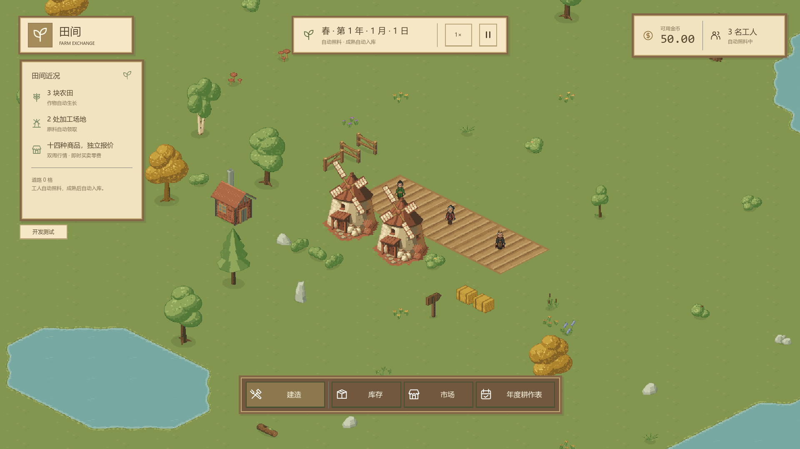
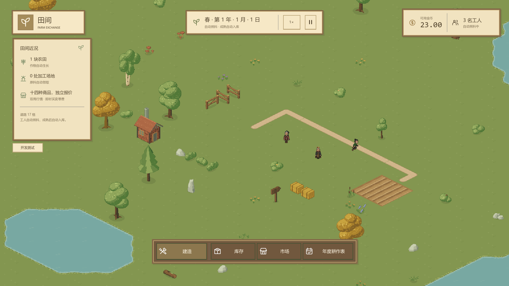

# 水域地形与草土水素材规划

## 当前确认范围（2026-10-14）

正式采用 Godot 原生导航、1/32 格保守简化和额外离岸 1/8 格，脚底半径 0.125 格、数值余量 1/256 格保持。原生 RDP 后以一次 Round 合并外扩与简化补偿，原始岸线继续决定水域和建造；不增加栅格导航或游戏磁盘缓存。下方参数待确认的描述属于此前实验阶段。

道路优先已确认：全部材质同等，道路原生区域成本 1、普通陆地 2，实际工速仍每经营秒 3 格。建拆后新领取或重新规划采用最新同步道路，已有行程保持到本次任务结束。准备期间暂停完整经营 tick，窗口保持响应，等待正常 MapChanged；纯陆地与含水共用此约定。连续原生导航按既有道路占地划分成本区域，不增加第二套搜索或栅格通行表示。正式实现、中文接口及测试已接入；完整验收和 PR 状态统一见 #110 顶部记录。

## 1080P 实际画面

2026-10-14 正式含水主场景，种子 12345，保守简化与额外离岸参数均采用上述确认值。完整准备约 26.1 秒；截图来自真实 Godot 图形验收，详细运行事实仍以本轮完成记录为准。



同局实际建路后的工人行走画面。道路成本参与原生选路，真实工人采样每经营秒前进 3 格；完整建拆对照与四档倍率报告保存在 `build/issue110-validation/water-performance/`。



关联 [#110](https://github.com/Fotally/Farm-Exchange/issues/110)，归属 [#105](https://github.com/Fotally/Farm-Exchange/issues/105)。2026-10-12 进入正式实施，沿用已确认参数、纯陆地配置组合和近景参考尺寸口径。本页保留素材／接口／一次性原型证据及其局限；此前阶段的“不启动实施”仅描述当时状态。现行行为以[地形接口](../architecture/terrain/interface-terrain-map.md)、[建造规则](../gameplay/land/opening-and-building.md)和[道路规则](../gameplay/land/roads.md)为准；以下诊断、选型和原型按当时状态保留。

## 诊断与选型阶段记录（历史）

2026-10-13 本轮继续顺序已确认：先查明正式路线净空检查失败，再用成熟几何实现进行保守简化实验，按准备／查询耗时、通行差异和1080P实际观感确定容差。初版更重视人物与水边有清楚的视觉距离，允许评估较大容差或退让；具体放宽值仍在给出实测结果后确认。暂不增加栅格通行表示或磁盘缓存。当前的1/256格余量在实验选型完成前继续作为正式实现值，不能把实验参数写成现行规则。

2026-10-14 已将净空失败缩减到6顶点，确认原生射线重复计数共享顶点造成水内外误报；另查明细长三角形的浮点投影使真实连续起点偏移。等价分类及不改变几何的面索引整理修复后，正式种子0、1、110及重复种子0均通过完整路线、合法工作中心连通和各100次取消接续。

保守简化改用原生RDP加单次Round总外扩，并完整验证覆盖基准脚底障碍。种子0的1/32格档将576块烘焙从14.54秒降至3.96秒，近景查询从20.70毫秒降至1.54毫秒；增加1/8格视觉离岸的同档分别为4.16秒、2.05毫秒，近景距原岸最小值约0.271格。两档均保留全部128,914个合法工作中心并通过自身路线100次取消；旧基准贴岸起点分别有11/39、13/39被新增退让拒绝。限定直线夹具的通道分别在0.33格、0.58格完整通过，不能继续沿用原始档0.26格的小通道结果作为新档保证。1/16格出现原生重复完整边，未通过，不作为可采用方案。

同图1920×1080默认和放大镜头对照已经采集。当前推荐1/32格简化加额外离岸1/8格，正在等待具体参数选择；正式实现尚未自行接入该放宽。详细数据及失败记录见[单次Round实验](../research/godot-water-navigation.md#单次round与视觉离岸实验2026-10-14)。本段为进行中记录，选择接入后仍须完成正式多种子、完整测试、图形性能及导出验收。

原参数的真实1920×1080主场景已通过四倍率水波逐变体像素、岸格干地与完整陆地不变、暂停整帧一致及FPS检查；平均478～549 FPS，P95不超过2.73毫秒。地形准备34.700秒，完整Main创建38.769秒，不能将实验烘焙耗时作为完整开局耗时。水波错相修复和普通FPS失败证据路径均完成独立复查；外部真实30FPS限帧验证了原门槛仍失败，并保留对应倍率原帧与阶段报告。

首轮完整自动化发现旧行情日志夹具在完整局释放后继续推进；现已区分日志观察关闭与完整局资源释放，保留三组原日志专项的事件顺序、计数和幂等检查，集中回归与独立复查通过。2026-10-14 原参数完整套件复跑全部通过，覆盖率总体13,206/13,591（97.17%）、地形977/1,017（96.07%），所有一级模块超过80%；16,384实例满图50 tick为170.72毫秒。证据为 `build/issue110-recovery/full-native-lifecycle-fixed-suite-and-coverage.log` 和 `coverage/coverage.cobertura.xml`。CI空白格式验证及格式后的独立复查通过，临时实验测试入口已备份并清理。这些阶段成果仍不表示#110完成交付，正式简化参数和最终Release验收尚待完成。

1. 完成严格、不可变的地形 JSON 配置契约；地图尺寸、真实开局占地和工人起点由经营组装输入，不在配置模块复制。
2. 按 2026-10-13 已确认的调整，使用 Godot 原生导航和引擎圆角偏移，替换自写搜索和无限精度移动坐标；采用下节明确的有限精度与异步建局约定。
3. 接入建造、整段道路、真实工人路线及表现；现有满图夹具显式选择合法纯陆地配置。
4. 完成独立审查、自动化测试和逐模块覆盖率、真实 1080P 画面与含水负载、Windows Release 导出和启动后，在 #110 顶部登记完成记录并创建 PR。

初始实施基准为 `dev` 的 `1d9c15c297fd0b228ef678403c29e8423ca3ce5d` 及工作区既有改动，启动差异保存在 `build/issue110-implementation/`。2026-10-13 在其他整合验收结束后恢复至 `e4c0da9e90e884335d830cbc57395ce272bdab12`，保留新工作凭据、异常检查点、道路与选框修复；恢复和重新验收证据保存在 `build/issue110-recovery/`。本节保留当时进行中的计划与阶段事实，最终交付以 #110 顶部完成记录为准。2026-10-14 在 `a58f0dcfa2780f8837e8ed75de66f879be1ac95a` 上整合并保留 #35 九份批量加工及其 UI／产能验收；新旧证据分存于 `build/issue110-batch-integration/`。

### 已确认的成熟导航方案调整（2026-10-13）

- 复用 Godot 的 `Geometry2D.OffsetPolygon` 圆角偏移及原生 A*／Funnel，不继续实现另一套搜索算法。脚底半径默认仍为 `0.125` 格，另采用 `1/256` 格数值安全余量；默认镜头下该余量最大投影约 `0.22` 像素。
- 导航使用统一的内部单位倍率与明确精度，完整真实路线仍须保证脚底不切水。撤销旧版“无额外退让、任意略宽于两倍半径都必须识别”的数学承诺；不将这一变化描述为完全等价优化。小型实验中 `0.251` 格通道不通、`0.26` 格通道可通，不据此承诺任意真实地形的统一临界值。
- 新局先准备导航并等待原生地图正常同步，完整成功后才开始经营；不通过强制冲刷全局导航队列伪装同步创建。纯陆地合法配置仍使用相同完整创建契约，无需创建无用导航区域。
- 运行位置和路径改用可控的有限精度值；保留实际连续起点、整数累计经营秒、单秒／批量一致以及到达秒不同时作业。引擎返回部分路径或最近点不能直接当完整到达，表现不修改经营位置。
- 调研与实测见[行业实践](../research/water-navigation-game-practices.md)和[原生导航](../research/godot-water-navigation.md)。本调整已确认，但真实岸线、全图生成、连续取消、完整场景、性能与导出仍待完成验收。以下旧技术章节中与本节冲突的精确圆通道或同步创建描述，属于已替代的方案证据，不再作为当前实现要求。

### 本轮导航实现方案

本节记录已尝试但**尚未验收、现已停止扩展**的自写实现。连续取消的有理坐标分母增长导致专项测试无法完成，不能作为正式交付方案。成熟实现核验见[行业实践调研](../research/water-navigation-game-practices.md)；外围绕行替换未获批准，不将其作为新规则。

地形采用固定的有限有理岸线模板作为几何权威，并单独认证模板与素材作者连续分类曲线之间的误差。每个生成候选须验证岸线对生成中心星形；用于搜索的凸包络由岸线凸包加脚底外接方形得到，创建时检查各包络分离且位于地图内缩区域中。

圆脚底是否合法仍按真实岸线的精确距离判断。起终点位于搜索包络内时，沿经过证明和扫圆检查的向外射线连接至包络边界；外部查询使用凸包络可见图。包络只帮助组织一条完整路线，不作为逻辑禁行区，不扩大脚底，也不承诺最短路。包络分离是本生成算法选择候选的充分条件；预算内没有满足它的布局应报告生成失败，不能宣称所有此类配置在真实圆净空下都不连通。

这一方案的模板误差证书、正式星形判定、多种子成功率、任意合法端点与完整路径仍待实现验证。固定近景在旧数值原型中满足星形，只是前置可行性证据，不能代替正式模板验证。

## 已确认范围

- 新局按独立地形种子生成静态池塘，同种子、生成版本和有效配置可复现；生成前保留中心设施、工人起点与必要扩建空间，保持可通行陆地连通。首版不提供挖填、桥梁、孤岛经营或地图编辑。
- 水域只影响占地和通行，不自动给农田供水，不增加捕鱼、作物加成或天气联动；岸线和水纹与功能共同交付。
- 农田、加工场地的九格全部为完整陆地才能建造；道路也不能进入含水岸格。含水岸格中足够宽的干地允许工人通行，建造判断不能直接作为通行判断。
- 工人按岸线几何约束寻路绕水，仍可穿越建筑和其他工人，不要求道路，不增加道路速度加成。经营系统唯一推进位置，表现读取真实路径，不用刚体物理响应控制经营。
- 保持每模拟秒三基础格，播种、浇水各占完整一秒。暂停冻结移动、作业和水纹，倍率沿用唯一时间驱动。
- 两日照料预算归 [#154](https://github.com/Fotally/Farm-Exchange/issues/154) 独立待观察。本单不分析绕行成本、不重证两日预算、不要求水域附近两日达标，也不为此限制池塘形状、保护标准预算布局或调整工速、人数。真实路径仍消耗真实模拟时间。
- 首版自然池塘使用现有草水过渡，不强制生成泥土岸带；保留完整草／土／水素材映射。已确认参数与算法分离，配置作为正式代码工件维护；调整只对新局生效，不提供运行中热更新或游戏内调参界面。

现行地图为 384×384 基础格，生产设施 3×3、道路 1×1。`LandOccupancy` 保存建筑占用，`PlacementRules` 统一检查完整陆地、范围、占用和余额；`WorkerScheduler` 持有真实连续路线，`WorkerPresentation` 沿同一路线插值。现行规则见[路线图](roadmap.md)、[地图规则](../gameplay/world/map-and-camera.md)和[供水规则](../gameplay/production/water-and-rain.md)。

## 已确认默认参数

全部距离和尺寸以基础格平面为单位，不是屏幕像素。以下是正式默认配置的设计值，不是要求写死在算法中的常量；运行时依据本局有效配置执行。

### 池塘分布

| 类型 | 数量 | 长轴完整长度 | 短轴完整长度 |
| --- | ---: | ---: | ---: |
| 小池塘 | 16 座 | 8～14 格 | 6～10 格 |
| 中池塘 | 24 座 | 18～26 格 | 12～18 格 |
| 大池塘 | 8 座 | 28～36 格 | 18～24 格 |

- 总数由三档相加得到 48 座，不另设可编辑总数；长短轴允许旋转，尺寸范围为生成结果需要满足的约束。
- 水面目标占比 8%，允许范围 6%～10%。按最终岸线围成的实际水面面积除以地图面积统计；含水岸格造成的禁建面积另计，不代替水面面积。各档中间尺寸按椭圆估算约 7.8%，只是参数量级估算，不是已完成的生成验证。
- 池塘之间的最终岸线距离至少 8 格；地图最外圈 8 格保持完整陆地。分区随机散布，允许局部疏密变化，不按等间距网格摆放。
- 轮廓以圆润不规则椭圆为主，边缘扰动不超过对应半轴的 15%；扰动后仍须满足尺寸范围、间距和保护区约束。不生成内部岛屿、细长水沟或深窄裂口。
- 16 座小池塘中包含 1 座近景池塘，生成参考椭圆的完整轴长为 10×7 格；2026-10-12 已明确该口径，最终岸线不要求恰为 10×7，但仍须满足小池塘尺寸范围及所有其他硬约束。其最近岸线距地图中心 14～18 格，位于中心保护区某一侧中段。它不是第 49 座，也不是额外再随机抽取参考尺寸的普通小池塘；配置参考尺寸和最终岸线范围均须校验。具体侧向与画面落点通过默认镜头和 UI 遮挡校准，不承诺当前已经验证开局可见。

### 中心保护区

- 保护区宽高均为 24 格，以地图几何中心 `(191.5,191.5)` 居中；默认覆盖横纵坐标均为 180～203 的基础格，共 576 格。
- 全部保护格的四角均无水，不能只检查格中心。池塘最终岸线到保护区外边界至少 2 格。
- 配置保存保护区宽高，不重复保存默认起止坐标；格区间由地图尺寸和居中规则派生。调整宽高后仍须覆盖真实开局设施全部占地和工人起点；不满足时拒绝配置，不搬动开局设施。
- 保护区只服务开局和扩建，不与两日照料预算或工人产能绑定。

### 工人脚底

- 统一采用基础格平面上的圆，半径 0.125 格（1/8 格），直径由半径推导为 0.25 格；所有工人、朝向和动作共用，以现有脚根为中心。
- 原生导航另采用已确认的 `1/256` 格数值安全余量；脚底形状仍为圆，不沿用人物场景原有碰撞胶囊。半径是本期可调参数，数值余量属于固定实现约定，不预建形状选择器。
- 按现有等距换算，投影约为 11.3×5.7 地图像素，默认镜头倍率 1.25 下约为 14.1×7.1 屏幕像素。像素尺寸是派生说明，不进入配置，不受 UI 倍率影响。
- 默认两岸有效干地宽度大于 0.25 格是物理上容纳脚底的必要条件；原生导航还计入上述数值余量与有限精度，不保证任意略宽于直径的通道都可通。恰好等宽、点接触或转角容不下整个脚底均不构成有效通路。头部和工具悬于水面上方不决定通行。

## 配置管理作为 Module 的正式契约

配置文件、字段定义、校验规则及默认值共同纳入 Git，与实现一起审查、维护中文说明并执行验收；数值调整也是代码变更，不能绕过约束验证。当前实施已建立独立 JSON 和严格加载器，其实际约定见[地形配置接口](../architecture/terrain/interface-terrain-rules.md)；完整生成及导航仍须单独通过下述门禁。

| 契约 | 约定 |
| --- | --- |
| 状态归属 | `TerrainMap` 所属 Module 唯一解释和验证地形配置。经营入口提供配置来源，工人、地图和 UI 不分别读取 JSON，也不另存脚底半径作为经营依据 |
| 加载与生效 | 新局创建时读取并验证，成功后形成不可变有效配置，本局固定使用。文件修改对下一局生效，不使当前岸线、路线或工人位置变化 |
| 完整入口 | 对外提交配置来源／显式有效配置和种子，获得完整地形或明确失败；解析、验证、生成和导航准备留在 Module 内部，不让调用方拼接内部步骤 |
| 可调范围 | 三档数量与尺寸范围、水面目标和上下限、池塘间距、地图边缘留陆、轮廓扰动、中心保护宽高和退让、近景池塘尺寸和距离范围、脚底半径 |
| 唯一数值 | 总数、直径、通道净空、保护区起止坐标及屏幕投影均派生；不另设第二份可编辑值。地图尺寸、工速和已有经营时长继续由原 Module 定义，不复制到地形配置 |
| 校验 | 统一检查字段、类型、有限数值、范围和跨字段约束；缺失／未知字段、类型不符或不合法值明确拒绝，不静默补默认值、截断或替换配置 |
| 错误语义 | 配置读取或校验失败给出来源、字段及原因；合法输入但生成不能满足约束时给出未满足条件。失败不发布半成品地形，不更改参数，不回退无水图 |
| 正式与测试 | 同一配置加载、校验和生成 Interface；测试可显式提供合法变体，不用测试专用规则绕过正式检查。同进程多局各自持有配置，不使用可变全局配置 |

跨字段校验至少覆盖：范围上下限顺序；水面下限≤目标≤上限；长短轴关系；含水配置的小池塘数量须能容纳近景池塘；近景尺寸须落在小池塘范围；保护区及边缘留陆与地图尺寸、真实开局占地相容；脚底半径为正且实际工作位置有足够净空。不能只验证每个数值为正就接受整份配置。

### 已确认的纯陆地配置组合

2026-10-12 确认同一正式配置契约允许三档池塘数量全部为 0，同时水面目标、下限和上限全部为 0；近景池塘随之停用。默认游戏仍使用 16／24／8 座池塘和目标 8%、允许 6%～10% 的含水配置。纯陆地配置用于保留现有 16,384 实例性能基准，经同一完整创建 Interface 生成地形、几何及导航，不增加测试开关、跳过校验或构造失败后的替代地图。

这是明确选择的合法输入组合，不是缺失参数时补值。配置仍须提供全部字段并通过类型、尺寸、保护区、地图边缘和脚底净空等校验；停用近景不免除字段校验。三档数量全 0 而任一水面比例非 0、或仍有池塘而三项水面比例全 0，均明确拒绝。个别池塘档位为 0 的其他组合尚未确认，不据此扩展合法输入范围。

局部合法的参数组合仍可能无法同时满足数量、面积、间距和连通性。加载阶段拒绝可直接证明的冲突，生成阶段再检查实际结果；两类失败须区分。8% 是目标，6%～10% 是允许区间，数量、尺寸范围、间距、保护区和连通性均为硬约束。计算达到明确上限仍不能生成合格地图时报告失败，不擅自减少池塘或放宽规则；计算上限及终止算法尚待技术设计定稿，不预先编造数值。

配置契约为地形提供真实的输入 Seam：外部不需知道 JSON 结构如何转换成岸线和导航；配置验证、派生值和错误集中维护体现 Locality。通用配置管理框架、热更新总线、参数注册器及可替换形状策略均无本期实际需求，不新增。公开配置只覆盖已确认独立参数，数值精度和搜索内部细节不机械变成用户可调项。

## 地形数据与岸线几何

### 唯一数据来源

拟由 `TerrainMap` Module 唯一拥有 `(MapSize+1)²` 个共享顶点的草／土／水标签、地形种子、生成版本和经验证的本局配置。地形在建局时生成，成功发布后不修改。岸线轮廓、通行区域、连通分区和寻路索引都是从这些数据派生的内部缓存，不允许调用方独立编辑。

建筑占用仍归 `LandOccupancy`；把水登记成建筑会混淆拆除、费用、完整占地和自然地表的职责。地形随机使用独立随机序列，不消耗现有开局作物、天气或行情序列。种子派生及生成算法作为版本化内部实现，在实施前明确，不增加玩家种子编辑入口。

### 完整陆地与岸格通行

完整陆地格要求四角均非水；含水岸格即使大部分为干地，仍不能放置设施或道路。工人通行按连续几何判断，不使用这个整格布尔值。

使用已确认的圆形脚底和本局配置半径表示所有工人的通行宽度，再经现有等距坐标换算到画面。脚底尺寸不取决于角色图片、工具、镜头缩放或 UI 倍率；1080P 对照验证实际效果，不重新把已确认默认值列为待定项。令脚底形状为 F、原始陆地区域为 L，则可行走的脚底中心区域为：

`W = { p | p + F 完全位于 L 内，且不越出地图 }`

W 表达物理安全范围；实际导航区域由脚底半径加 `1/256` 格余量的 Round 偏移与原生烘焙形成。路线逐段核验，不能只检查端点。点接触、等宽或更窄通道不通，有限精度下保留下来的岸格干地允许通行；不承诺识别 W 中任意略宽于直径的通道，也不套用“斜行两侧整格都必须无水”的整格限制。

### 岸线和素材校准

拟在地形实现内部维护与四角编码对应的稳定岸线几何模板，统一相邻格共享边上的交点，再拼接、裁剪和生成 W。草／土都属于陆地，但外观仍保留三元映射。只有核对确认轮廓相同后，才能合并具有相同水角分布的几何模板。

本轮已逐项核验包内水／陆 mask 和三变体一致性，两对角水采用水相连、两片陆地分离，具体证据见本页技术核验节。正式有理折线模板与原生导航已接入，接缝、数值余量与生成实现见[静态地形实现](../architecture/terrain/implementation-static-terrain.md)；全图和实际画面仍须通过验收，不把模糊边缘的零宽缝作为通路。

同一个组合的三种纹理变体必须使用相同逻辑岸线。mask 用于离线核对和水纹裁剪，运行时不从纹理颜色、透明度或动画帧反算通行规则。若变体与统一几何明显不符，应修正对应素材或模板并重新校准，不能以另一套隐形碰撞范围掩盖差异。

## 静态生成和开局约束

1. 校验生成参数，先划定中心完整陆地区，再生成保护区之外的池塘；保护区按开局和扩建需要确定，与两日照料预算无关。
2. 生成权威顶点标签，拼接岸线，按统一脚底形状生成可行走区域及连通索引。
3. 在 W 上验证连通性，而非仅检查非水顶点或格中心；中心设施全部九格完整无水，工人起点和所有合法生产设施工作中心属于同一可达区域。
4. 参数约束和生成算法须能保证上述条件，再发布不可变地形并初始化开局设施。构造失败返回明确原因，不能静默改成无水图、瞬移工人或移动开局设施。

池塘数量、尺度、覆盖率、间隔及中心保护区采用上文已确认配置。生成算法、固定选择顺序及候选预算已记录于[静态地形实现](../architecture/terrain/implementation-static-terrain.md)，不采用无界重抽。正式默认配置仍须多种子验证；岸边过窄的干地可以成为不可通行边角，但不能把合法工作中心隔离成孤岛。

## Module 设计与最小 Interface

本节是按 `codebase-design` 整理的拟定设计，名称表达职责，不表示已有 C# 类型或要求新增 `interface` 关键字。

| Module | 唯一职责与状态 | 对外约定 |
| --- | --- | --- |
| `TerrainMap`，拟新增 | 地形标签、配置和种子；封装岸线、通行宽度、连通性及静态寻路索引 | 创建完整有效地形；只读地形查询、完整陆地判断、完整路径查询 |
| `LandOccupancy` | 建筑实例与子格占用 | 保持现有登记和移除，不持有水域表 |
| `PlacementRules` | 综合地形、占用、范围和资源检查 | 预检和正式执行使用同一判断，返回稳定失败原因及费用 |
| `WorkerScheduler` | 任务认领、实际位置、已接受路线及路线推进进度 | 从当前位置求路，按模拟时间移动；暴露只读移动结果，不外泄搜索图 |
| `FarmGame` | 组装上述对象及经营相位 | 地形先于设施和工人初始化；建造完整提交、聚合只读结果 |
| `WorldMap`、`WorkerPresentation` | 地形和真实移动的表现缓存 | 同一坐标和路径绘制、插值；不修改地形、工人位置或资源 |

拟定 `TerrainMap` 的小 Interface：

| 操作 | 输入、结果与约束 |
| --- | --- |
| 创建 | 输入种子及经验证的不可变配置；含水局等待异步完整创建，Module 内部完成生成、烘焙及正常物理帧同步，成功才发布对象并启动经营。调用方不自行拼装这些步骤；失败明确报告原因，退出取消并释放资源 |
| `GetCell(cell)` | 返回四角标签及只读地表信息，供绘制和反馈；不暴露可变顶点数组、纹理对象或导航容器。越界输入明确拒绝 |
| `IsFullLand(cell)` | 返回整格是否完整无水，地图外为 false；供建造规则检查全部 footprint，不等价于人物通行 |
| `FindLandPath(start, target)` | 输入基础格平面的真实位置和目标；返回完整有效的不可变路径及累计长度，或明确的起终点无效／不可达结果。不返回当作成功的部分路径，不吸附或瞬移起点、目标 |

路径的方向距离、累计长度和按距离取位置由路径结果内部统一表达，供调度和表现读取，避免两处复制路线度量。调用方只接收完整结果，不自行拼接水域 mask、连通检查和搜索器。路径结果是实际被消费的值对象，不是新增通用导航服务。

**Depth**：一次路径查询封装岸线净空、连通检查、搜索和几何验证。**Locality**：修改岸线模板或通行精度集中在地形内部，建造与表现不复制规则。**Seam**：以只读地形和完整路径结果作为实际调用位置，测试也通过这些 Interface 验证。删除 `TerrainMap` 后，这些复杂知识会散入建造、工人和地图，新增它有实际必要。

地形内部可使用几何和搜索辅助类型，但不提前建立 `ITerrainProvider`、碰撞策略注册器、通用导航插件或多层转发。工人的任务轮转、路线进度和作业状态不能进入 `TerrainMap`；建筑和其他人物目前不阻路，建拆也不使静态地形导航失效。

## 寻路、经营推进与表现

### 路径实现方向

采用 Godot 静态多边形导航：建局时由引擎烘焙区域，查询时使用原生 A* 寻找通道、Funnel 收紧折线路径。项目检查真实圆脚底的整段净空，不另外维护格中心搜索或路径平滑算法。

具体实现采用已确认的 Godot Round 偏移及原生 A*／Funnel；同版本、同起终点查询须有稳定结果，首版不承诺全局最短路线。正式经营和测试使用同一入口，不依赖人物节点是否加载或镜头是否可见。

### 行程时间和取消

为保留现有横纵斜向每秒三格的口径，拟将每段长度定义为 `max(abs(dx), abs(dy))`，整条路径长度为各段长度之和；移动耗时为总长度除以三后向上取整。距离按整趟累计，不对每个转角分别取整。一秒可以越过多个路径点，但到达的这一秒不额外完成播种或浇水。

`WorkerScheduler` 唯一持有路线起点、累计移动距离和进度。单秒与批量推进使用相同累计公式及到达事件，不能在批量推进中直接穿过路径弯角，也不能因累计浮点误差导致不同推进方式到达时刻不同。

只在领取新任务、原任务失效后改选目标时求路，不按视觉帧全图重算。改种、拆除、降雨满足浇水、换季或休耕等沿用现有任务凭据重验；取消保留实际位置，新路径从该连续位置开始，不回退到最近格中心。成功求路后才提交任务认领；不可达不认领、不执行作业，并按稳定轮转继续处理其他有效需求。

有效正式地形应保证合法工作中心可达。不可达结果用于构造验证和明确失败测试，不为当前静态连通地图引入持久重试队列或隐藏传送。

### 路径表现

扩展只读工人移动结果以表达本次可播放的路线片段及进度；表现按同一路径取位置，不能继续仅对两端 `Lerp`。片段须涵盖这一经营秒中的全部转角。批量跨过多个经营秒或开发高倍率时，不积压历史动画；缺少连续播放区间时直接对齐最新真实位置，不以跨水直线补动画。

暂停对齐并保持真实位置；恢复后继续同一路线。角色朝向由当前路径段决定，工作动画仍只消费真实成功结果。人物脚底约束在经营层生效，不通过刚体、逐帧碰撞推挤或动画回调修改经营。首版无需额外铺设一套场景物理碰撞节点；调试可直接绘制相同岸线和 W，核验几何而非建立第二份规则。

## 素材切片和地图坐标

来源相对于 ZIP 根 `FarmExchange-Bright-Complete-v2/`，基准见[清亮 v2 分析](../research/bright-complete-v2.md)。2026-10-12 已再次读取包内 terrain manifest，以下为素材事实，不是新增玩法参数：

- `default/static/terrain/manifest.json`：草=2、土=1、水=0；角序 top、right、bottom、left；`code = top + 3×right + 9×bottom + 27×left`，范围 0～80。
- 图集序号 `index = code + 81×variant`，variant 为 0～2；三变体是纹理差异，不是 q0～q3 朝向，索引依据为包内 `previews/world/scripts/scene_view.gd`。
- 九列，stride=(68,36)，padding=2；切片左上角 `((index%9)×68+2, floor(index/9)×36+2)`，尺寸 64×32。普通图用 `terrain_81.png`；项目现有菱形网格使用 `terrain_81_mesh.png` 及其菱形 UV，不能混用采样方式。
- mask 为 `masks/water_81.png`、`land_81.png`、`soil_81.png`、`grass_81.png`；水纹为 `ripples.png`。mask 不承担另一份经营规则。

`MapCoordinates` 的格坐标表示格中心。拟令顶点 `V[x,y]` 位于格空间 `(x-0.5,y-0.5)`；格 `(x,y)` 上、右、下、左角依次为 `V[x,y]`、`V[x+1,y]`、`V[x+1,y+1]`、`V[x,y+1]`。相邻格使用相同共享顶点和岸线交点。地图边缘取已保存的最后一行／列顶点，几何和绘制均裁剪于地图，不查询越界格。

全水 code=0，全土=40，全草=80；仅顶角为水而其余为草时 code=78；顶右为水而底左为草时 code=72。后两者都禁建，但能否行走必须查询实际干地区域与脚底净空，不能从“禁建”反推“整格禁行”。

## 表现接入与资源边界

- 保留现有地形分块缓存，静态数据只在建局准备，镜头移动不重建岸线或导航；只绘制可见块及必要外扩范围，水纹单独更新。
- 水纹按水面 mask 裁剪，不覆盖陆地、建筑或 UI；暂停和倍率读取现有统一时间来源，不产生供水事件。
- 建造预览从正式规则得到逐格地形阻塞和原因，含水格明确高亮；道路整段任一格含水即整段失败，金币、占用、作物和环境装饰均零修改。
- 环境装饰使用相同地形信息过滤不适合的陆地落点，避免树木／人工陈设落入池塘；落点过滤不变成建筑占用或工人障碍。具体岸边装饰随素材校准核验，不扩展采集玩法。
- 本轮不增加存档。未来保存须考虑种子、生成版本、配置和地图尺寸的完整重建条件，不能只记种子；实际存储格式由存档任务决定。

## 后续实施单元与依赖

以下单元已获实施授权，完成代码及中文文档后按项目约定集中独立审查；不按文档小节机械拆分 Module。

| 单元 | 主要变更范围 | 完成条件 |
| --- | --- | --- |
| 地形与几何 | 拟新增地形实现、正式 JSON／字段校验／默认值、素材几何数据和单元测试 | 已确认参数与算法分离；同一配置契约下可复现生成，岸线、净空、连通、失败结果通过实际 Interface 检查 |
| 经营与通行 | `FarmGame`、`PlacementRules`、`WorkerScheduler`、工人快照及测试 | 完整禁建、稳定认领、真实绕行、取消和单秒／批量等价；没有两日预算门禁 |
| 地图与输入反馈 | `WorldMap`、`WorkerPresentation`、预览、环境装饰、水纹素材及集成场景 | 地形与预览一致，沿路径插值无切水，暂停／倍率正确，1080P 效果成立 |
| 联合验收 | 玩法／接口／实现文档、根系统结构、测试与构建流程 | 逐模块覆盖率、性能、指定引擎编译／测试／Windows Release 导出／启动按项目约定通过 |

地形先供经营和表现使用，功能与素材共同交付。不能只显示水面而仍允许穿水，或仅阻止经营却缺少岸线反馈。现有满地图 16,384 实例的纯陆地负载基准必须保留，另增含水寻路负载用例，不得通过减少实例数量冒充原性能验收通过。默认新局不能直接生成纯陆地；既有基准显式选择上文已确认的纯陆地配置，经同一校验和创建入口准备后再填充设施。所有使用满图夹具的场景和探针都需核对配置来源，不只调整一项性能测试。该兼容规则已接入正式配置、测试夹具和探针，仍以实际测试报告判断验收结果。

## 可执行验收矩阵

下表为将来需要执行的检查，不表示当前已通过。

| 场景 | 必须满足的结果 |
| --- | --- |
| 配置字段、范围、互相冲突的参数 | 缺失／未知字段、类型错误、非有限数值、倒置范围和跨字段冲突明确失败；没有补默认值、裁剪或静默改参 |
| 配置变体、新局生效、同进程多局 | 正式与测试共用加载和执行；纯陆地全零组合经同一入口，矛盾组合明确拒绝；修改文件不改变已有局，新局使用新配置；多局互不污染，总数／直径等派生值没有双重来源 |
| 默认池塘参数、生成上限、近景池塘 | 默认为16／24／8共48座，近景计入小池塘；按最终岸线检查尺寸、扰动、面积6%～10%、间距与保护；失败有界且明确，不少生成或放宽约束 |
| 默认中心区、脚底和1080P近景 | 180～203完整无水且岸线退让满足配置；半径0.125、导航另加1/256格余量，等宽通道不连通；近景位置核对实际UI遮挡，无强制泥土岸带 |
| 81×3 图集、跨块邻格、地图四角 | 切片／mask 对齐、共享边无裂隙；同组合不同变体不改变岸线或通行 |
| 直岸、凹岸、两对角水、极窄干地、点接触 | 核对有限精度导航的通行与拒绝案例；脚底扫过区域全程不碰水；零宽连接不通；模板与画面一致，不以任意略宽于直径必通作为门禁 |
| 多种子生成、中心开局、地图边缘 | 同版本同配置可复现；全部开局占地无水，工人起点和合法工作中心在同一可达区域；构造失败明确 |
| 3×3 跨岸、单格道路、整段道路跨水 | 预检与执行一致拒绝，逐格反馈正确，失败资源及装饰零修改；不因岸格可走而允许建造 |
| 池塘两侧、同点、连续位置起步、不可达夹具 | 路径完整合法；同点无行程，非法起终点明确拒绝，不认领不可达任务、不吸附或瞬移 |
| 一秒跨多个转角、长路线、批量推进 | 按整趟距离计时；单秒和批量的位置／到达／作业／库存一致，到达秒不同时作业 |
| 途中改种、拆除重建、降雨、禁播、换季 | 原凭据失效，保留实际位置并重新求路；无重复认领、过期作业或无限重试 |
| 公共倍率、开发倍率、暂停、镜头外 | 经营结果不受渲染影响；表现沿真实路径，不切水或积压动作，暂停停止水纹和移动 |
| 1920×1080 图形与负载 | 检查岸边脚底、预览、水纹和装饰；记录前后截图、平均至少 60 FPS、P95 帧间隔不超过 16.67 ms；保留满地图基准并覆盖含水路径负载 |

路径几何正确性、实际移动时间和公平轮转仍属 #110；照料是否在两日内完成只在 #154 另行观察，不据此修改本单测试阈值或生成规则。

## 历史设计检查与技术原型证据

以下记录 2026-10-12 的设计和原型阶段，按当时语境保留。正式实施已获授权；其中待定工具、精确圆通道完备性和同步创建要求已由本文顶部 2026-10-13 的确认替代。当前状态以本文顶部与 #110 最新完成记录为准。

### 当时的遗漏检查与剩余设计工件

玩法范围、默认数值、配置归属和生效方式已确认。以下仍是待完成的技术设计或验证，不是已经通过的结果，也不作为重新选择玩法参数的理由：

1. 生成算法：确定独立种子派生、分区分布、轮廓扰动与固定选择顺序，给出有限计算上限及失败说明；核验默认配置能同时满足数量、实际面积、间距、中心保护和脚底净空后的连通性。不能凭椭圆面积估算宣布生成可行。
2. 配置契约落稿：确定文件位置、字段名、来源定位及配置／生成版本的兼容检查、居中格区间的奇偶取整规则。公开参数和派生值按上文约束划分，不因此创建通用框架或存档系统。
3. 几何校准表：素材 mask、三变体一致性和对角水拓扑已有本轮离线核验，见下节；连续模板顶点、共享边交点、容差及圆形脚底的精确净空仍需验证，再确定剖分和搜索工具。离线像素一致不等于已有可用碰撞或导航网格。
4. 1080P 对照：按已确认半径检查直岸、凹角、窄道及 code=78／72；按近景池塘10×7、距离14～18检查默认镜头和UI遮挡，完成侧向／落点安排。若效果或素材冲突需要改动已确认规则／数值，先沟通再调整。
5. 默认固定多种子的数值原型证据见下节，仍须完成真实生成的精度和净空认证、含水寻路负载与生成耗时／内存验收。按已确认的纯陆地合法组合接入既有16,384实例夹具的全部调用方，不以默认含水配置冒充原基准，不增加校验例外；契约已明确，正式配置及接入待实施。不加入两日照料预算门禁。原型不等于正式生成器或图形验收。

当前授权包括规划文档、issue 同步，以及仅在 `build/issue110-design/` 编写并运行一次性技术原型验证；正式 JSON、校验器、生成器、导航及场景修改均留待后续实施。原型不移入正式 Module，不记作游戏功能交付。#110 继续覆盖设计与确认后的实施，仅在需要独立交付时建立关联子议题，不重复建立相同目标的实现议题。

## 2026-10-12 技术核验与接入闭包

本轮基准为 `dev` 的 `1d9c15c297fd0b228ef678403c29e8423ca3ce5d` 和开始时工作树快照；现有未提交改动保留。以下区分真实代码接缝、素材证据及技术建议；授权后执行的一次性数值原型结果集中见本页末节。正式生成器、正式导航、1080P 游戏画面和游戏构建验收均未运行。

### 经营与表现必须覆盖的入口

| 真实入口 | 后续实施要求 |
| --- | --- |
| `PlacementRules.Check`、`FarmGame.CheckPlacement`／`PlaceBuilding`／`PlaceInitial` | 普通预检、正式建造和开局初始化都使用同一完整陆地判断；完整地形先创建成功，再初始化设施和工人 |
| `FarmGame.CheckRoadPlacement`／`TryPlaceRoads` | 当前整段道路直接查询范围、占用和资金，不经过单建筑的 `PlacementRules.Check`；必须接入同一地形判断并保留整段一次结算，不能只修改单建筑路径 |
| `WorkerScheduler.SelectNextWork`／`BeginWork`／`AdvanceTravel` | 当前选中候选立即认领，行程按直线端点计算；后续先拿到完整合法路线再提交认领。失效统一释放，保留实际连续位置 |
| `WorkerScheduler.GetNextEventSeconds`／`AdvanceQuietSeconds`、`FarmGame.AdvanceTicks` | 抵达仍为真实经营事件；转角不必成为额外经营事件。单秒和平静推进共用整趟累计距离公式，不逐转角取整 |
| `WorkerSnapshot`、`WorkerPresentation._Process` | 现有快照只有位置端点，端点 `Lerp` 会切岸；需读取不可变路线及有效移动区间，按路线取位置和当前段朝向 |
| `FarmGame.FillWorldForBenchmark` 及全部调用方 | 满图夹具当前直接填充地图。后续显式选择已确认纯陆地组合，经同一创建入口准备；headless、FPS、天气／日志负载和单元夹具都需核对 |

`WorkerScheduler` 继续唯一持有任务、认领、实际位置和路线进度；`TerrainMap` 不获得这些状态。建造、道路、工人和绘制都消费同一个局内地形对象，不能各自复制水域数组或读配置。

### 配置字段、版本和保护居中

正式配置来源为 `res://assets/gameplay/terrain/terrain_rules.json`。下表为首版字段落稿，数值口径取本页已确认参数，不新增可调玩法项；解析与错误说明以[地形配置接口](../architecture/terrain/interface-terrain-rules.md)为准。

| 字段建议 | 对应内容与类型 |
| --- | --- |
| `SchemaVersion`、`GenerationVersion` | 配置结构与生成语义版本，整数，非调参项；当前建议首版均为 1 |
| `Small`／`Medium`／`Large.Count` | 各档整数数量，近景计入小池塘 |
| 各档 `LongAxis.Min`／`Max`、`ShortAxis.Min`／`Max` | 基础格完整跨度范围 |
| `WaterCoverage.Target`／`Min`／`Max` | 最终水面面积比例，配置存比例值 |
| `MinimumPondSeparation`、`MapEdgeLandWidth`、`MaximumOutlinePerturbation` | 岸线间距、整数边缘完整陆地宽度、半轴扰动比例 |
| `CenterProtection.Width`／`Height`／`ShoreClearance` | 整数保护格数、岸线到保护区外边界的退让 |
| `NearPond.LongAxis`／`ShortAxis`、`NearPond.CenterDistance.Min`／`Max` | 近景参考椭圆完整轴长、最终最近岸线到地图中心的距离；不另设启用字段 |
| `WorkerFootRadius` | 基础格平面的圆脚底半径 |

建议拒绝重复属性以及未知／缺失属性，错误定位到来源和字段。版本只接受实现明确支持的组合，不自动升级；改变种子派生、候选顺序、岸线模板、几何量化或计算预算而可能改变结果时，更新生成版本。相同版本不通过环境差异默默执行另一算法。新局读取文件，不能照搬正式天气配置的进程级 `Lazy` 缓存，否则文件改动不能在下一局生效。

对地图轴长度 `N`、保护格数 `S`，建议 `start=floor((N-S)/2)`、`end=start+S-1`。默认仍得 180～203，外边界 179.5～203.5；奇偶无法精确居中时固定向较小坐标偏半格，不新增偏置参数或扩大保护格数。先验证尺寸，再检查真实开局占地及工人起点覆盖。真实开局完整占地为 x=189～197、y=189～194，工人起点为 (190,190)、(193,190)、(196,190)，不因配置变更移动开局。

### 有界生成的候选流程

以下为未实施的技术建议，尚不能证明默认配置可生成合格地图：

1. 完整校验配置并派生开局保护几何；显式纯陆地组合经同一入口建立全陆地和导航。含水配置继续后续池塘生成步骤，两者都不能发布半成品。
2. 固定局种子、生成版本和地形域标记的字节编码，派生独立地形序列；不增加现有作物／天气／行情随机抽取。研究使用固定算法和固定字节序，不依赖进程字符串哈希或运行时 `Random` 的跨版本保证。参照 [Microsoft Random 说明](https://learn.microsoft.com/en-us/dotnet/api/system.random?view=net-10.0)、[PCG 官方实现](https://www.pcg-random.org/download.html)。
3. 以布局尝试、近景／大／中／小阶段、池塘编号和候选编号固定候选身份及选择顺序。近景占一个小池塘名额；随后优先放大、中、剩余小。保护区外分区按可用面积随机抽取中心并区内抖动，不强制等量或等距网格。
4. 用内部低频平滑扰动提出圆润椭圆候选，生成共享顶点标签并按同一模板重建最终岸线。候选只有唯一无孔闭环才计为一座池塘；合并、分裂或出现岛屿即拒绝该候选。
5. 对最终岸线检查轴跨度、扰动、保护退让、地图边缘完整陆地及池塘间真实最短距离；源椭圆和包围盒仅用于筛选，不能当作最终合格结果。
6. 完整数量生成后检查实际面积允许区间，目标比例用于合法候选择优。构建圆脚底可行走区域和连通索引，验证工人起点及全部合法生产占地的工作中心；复用 `BuildingFootprint`，不以普通非水格中心代替工作中心检查。
7. 所有硬约束及导航准备通过才发布局内不可变地形。达到预算返回具体失败阶段和未满足条件，不重抽到无穷、不减少池塘、不放宽规则。

候选生成应由版本固定的“完整布局尝试预算 B”与“每座候选预算 C”控制，池塘数 N 时最多 B×N×C 次候选评估；预算是内部版本语义，不作为公开调参。B、C 数值须经真实样本和性能证据定值。岸线拟合、圆净空认证和导航准备还需各自的结构／精化上限，不能将候选预算冒充完整创建上限已经确定。

最终轴跨度建议按候选记录的正交主轴上投影的最大值减最小值测量，不事后重拟合轴使检查通过。扰动需针对最终岸线定义可测误差并结合无孔、无裂口检查；其数学测量与连续几何误差尚未定稿，不把技术解释写成已经确认的玩法。近景使用已确认的参考椭圆 10×7，最终曲线继续校验小池塘范围和其他硬约束，不以参考尺寸替代结果测量。

### 素材 mask 与连续岸线证据

核验来源为 ZIP 内 `default/static/terrain/manifest.json`、四张 mask、两种 terrain 图集及 `default/static/tools/terrain_authoring/generate_ternary.py`。只读源码并独立计算水分类，没有执行包内生成脚本。离线分析脚本、逐项统计和分析图在 `build/issue110-design/shoreline/`。

- 普通／mesh 图集均为 612×972，四张 mask 为 612×324，仅一份逻辑几何。水／土／草 mask 在有效 alpha 内互斥完整覆盖，`land=soil∪grass`。
- 三纹理变体 alpha 相同；以核验过互不相交的水／土／草 RGB 色板逐像素比对，三变体水区域与同组合水 mask 差异均为 0。草土替换不改变水 mask，81 组合实际对应 16 种水角几何。
- 对角草水组合是 code20=(2,0,2,0) 和 code60=(0,2,0,2)，采用水相连、两片陆地分离。code78 是单角水，code72 是相邻两角水，不作为对角案例。

作者公式提供可追溯的连续分类依据。令四角非水标记为 a0～a3（陆地=1，水=0），局部格坐标 u、v 的双线性值为：

```text
B = a0(1-u)(1-v) + a1u(1-v) + a2uv + a3(1-u)v
w = sin(πu)sin(πv)
L = B + 0.023 sin(23u+11v)sin(21v-4u)w
```

仅两对角非水排列再减 `0.085w`；`L<0.5` 是水，否则为陆地。按普通切片像素中心对应的 u、v 独立计算，与全部 81 张水 mask 的逐像素差异为 0。顶／右／底／左对应 (0,0)／(1,0)／(1,1)／(0,1)，世界位置为 `(cellX-0.5+u, cellY-0.5+v)`。

共享边上 w=0，扰动及对角修正消失，异标签边交点为参数 0.5。离线枚举两个方向 1,458 对合法相邻组合，每边比较 257 个位置，最大分类场差异为 2.32×10⁻¹⁸；分析图核验未见模板交点冲突。这个结果不替代连续模板、圆净空或 Godot 采样验收。正式绘制继续使用 mesh 图集和菱形 UV，不以分别缩放普通透明 Sprite 产生的采样缝否定素材几何。

连续模板可研究从作者公式提取并认证误差，不能直接把二值像素轮廓作为正式导航。格内微扰在直岸也存在；共享边交点为半格不保证曲线极值在半格，所以水顶点连续 10×7 或源椭圆 10×7 不能证明最终尺寸严格成立。一次性实验据此确认了参考尺寸与最终跨度的区别，近景尺寸现按上文已确认的参考椭圆口径执行；不新增容差兜底，各档最终尺寸范围仍是硬约束。

### 1080P 近景和水纹的分析范围

默认镜头对准地图中心，倍率 1.25；相对格位置 (dx,dy) 投影为 `(960+40(dx-dy), 540+20(dx+dy))`。离线示意优先比较 +y 侧中段的左下位置，源椭圆候选中心约 (+0.5,+18)，画面中心约 (260,910)。分析图上的水面约占 x=16～504、y=787～1031，与源码推导的顶部、近况最小矩形、右侧详情和底部入口没有重叠。

这只证明研究候选有画面空间；最近岸线距离和保护退让后续已有数值原型测量，但一般误差认证和真实动态 UI 高度仍未验证。示意是静态 CPU 投影，不是正式游戏截图，尚未选定近景侧向／落点。开发按钮、字号重排、暂停和倍率均需真实 1080P 场景复验。

`ripples.png` 为 96×24，即四片 24×24 水纹；包内预览只选一片静态放置，不提供已确认动画周期。建议表现内部按真实水 mask 裁剪，跨块共用世界坐标相位，视觉随机与经营随机分离，暂停和倍率读唯一时间驱动；周期、密度和布局待画面验收，不凭四片图片编造帧率或玩法参数。

### 路线结果与时间公式建议

折线路线的累计长度为 `L = Σ max(|Δx_i|, |Δy_i|)`，行程秒数为 `ceil(L / 3)`；累计行走 `t` 个完整经营秒时，从同一路线采样 `min(L, 3×t)` 的位置。整趟长度一次计算，推进使用整数累计秒，不反复累加已舍入位置。到达秒仍只移动，随后播种、浇水各用完整一秒。该公式保留原横纵斜向速度口径，不增加全局最短路线承诺。

最小路径结果建议包含完整不可变路线、总长度及按距离取位置／方向；经营向表现发布路线引用、本次有效距离区间和经营秒凭据，不每秒复制全路径或维护历史动画队列。连续区间才播放，批量跳过、首次挂接或高倍率直接对齐真实位置；暂停清除旧播放区间，恢复读取新经营区间。技术计算上限或几何认证失败应与业务“不可达”区分，不能返回部分成功路线。

### 圆脚底与导航工具的限制

本轮核验了以下工具的官方能力，尚未决定引入依赖或选定最终导航实现：

| 候选 | 已核验能力与限制 |
| --- | --- |
| Godot `NavigationPolygon`／`NavigationServer2D` | 多边形烘焙、服务器路径查询可作为候选；顶点按 `cell_size` 栅格化，区域可以按边距离连接，服务器修改一般需物理帧同步。不能直接保证本单的严格通道拓扑、精确圆净空及建局立即就绪。见 [NavigationPolygon](https://docs.godotengine.org/en/stable/classes/class_navigationpolygon.html)、[NavigationServer2D](https://docs.godotengine.org/en/stable/classes/class_navigationserver2d.html) |
| Clipper2 | 适合研究多边形布尔拼接；Round offset 用短直线近似圆弧，浮点输入也会缩放为整数计算。不能将一次负偏移宣称为精确圆净空。见 [ArcTolerance](https://www.angusj.com/clipper2/Docs/Units/Clipper.Offset/Classes/ClipperOffset/Properties/ArcTolerance.htm)、[Overview](https://www.angusj.com/clipper2/Docs/Overview.htm) |
| Godot `AStar2D` 或内部稳定图搜索 | 可研究连接代价和启发式；搜索器不提供岸线、脚底净空或图的完备性。等价候选的固定选择顺序也需验证。见 [AStar2D](https://docs.godotengine.org/en/stable/classes/class_astar2d.html) |
| 精确圆弧偏移 | CGAL 文档提供直线段与圆弧的精确偏移研究依据；C# 接入、许可和双平台导出均未核验，不决定引入。见 [Minkowski Sums](https://doc.cgal.org/latest/Minkowski_sum_2/index.html) |

对一条直线路段，脚底扫过区域为胶囊；建议依据权威岸线解析验证中心线的陆地归属、与岸线段的最小欧氏距离及地图界限。不能只检查端点或间隔采样。半径只读取本局配置，不因工具限制暗中放大脚底或增加退让。

“返回路线全程安全”和“连通判定完整正确”是两项独立证明。最终扫圆复验只保证前者，无法证明圆弧近似没有错误封闭略大于 `2r` 的通道。恰好等宽、点接触和零宽线不连通；严格足够宽的实际通路必须能识别。精度、圆弧表示、拓扑认证和有界终止仍待完成，不预填未经验证的 epsilon、圆分段数或依赖版本。

### 后续验证的计数与证据

- 默认多种子必须输出最终岸线水面面积、禁建格面积、数量、各池塘最终尺寸、岸线间距、中心／边缘留陆和可通行连通性，不能用源椭圆参数代替结果检查。
- 导航同时检查 `<2r`、`=2r`、`>2r` 通道、凹角、对角水、边缘、连续位置及整段扫圆；路线安全检查不能替代连通检查。
- 单秒与不同批量切分比较位置、到达秒、作业、库存和任务凭据；覆盖一秒多个转角、末段不足三格及整趟距离在三格倍数附近。
- 性能记录岸线段／偏移弧、索引节点／连接、精化步骤、搜索扩展、路线段数、建局耗时和峰值内存。确定性计算上限应按操作或结构计数，墙钟只作性能测量；具体上限待实现证据定值。
- 本轮静态检查与起始基线均仅报告三个既有源 ZIP 的命名错误；不修改其他任务资产或降低检查规则。原始快照、日志及素材分析保存在 `build/issue110-design/`，不纳入正式生成或游戏资源。

## 一次性技术原型结果与剩余门禁

本轮经明确授权，只在 `build/issue110-design/` 编写并运行原型。正式项目排除 `build/**/*.cs`，此目录也不进入 Git；原型不提交或搬入正式 Module。正式代码、场景、经营素材及项目配置共 723 个文件的前后 SHA-256 一致，已有工作区改动未被覆盖。下面的“符合”仅指指定数值模型和输入，不能当作正式功能、完整几何认证或游戏构建验收。

### 生成实验

最终版本为 `generation-experiment-3-reference-rule`，固定样本为种子 0～13、42、12345。每个布局最多 4 次尝试，每座候选最多 256 次；近景使用参考椭圆 10×7，相对地图中心约 (+0.5,+18)。这些预算是原型内部值，尚未定为正式生成版本预算。

| 实测项 | 最终 16 样本结果与限制 |
| --- | --- |
| 数量 | 均得到 48 座：近景 1＋普通小 15＋中 24＋大 8 |
| 水面面积 | 每格 64×64 采样、线性插值提取的闭合岸线按 Green 面积计算，结果为地图面积的 7.371723%～7.979430%；不是作者连续曲线的严格面积证书 |
| 池塘间距 | 数值折线间最小距离，所有样本最小值 8.052986 格；曲线拟合误差仍未认证 |
| 中心与边缘 | 保护区四角完整陆地、岸线退让及最外圈 8 格完整陆地的原型检查均符合 |
| 最终尺寸与形状 | 检查记录主轴投影范围、长轴≥短轴、归一化径向扰动、单一闭环及接缝；结论依赖数值轮廓，尚无一般误差与拓扑证书 |
| 重复输入 | 主 Agent 独立复跑种子 0／1／12345，水顶点摘要、数量、候选数、面积及最小间距一致；未做跨平台对照 |
| Release 耗时 | 单样本约 0.539～1.364 秒、中位 0.624 秒，仅本机原型测量，无正式性能阈值结论 |
| 内存 | 累计进程峰值约 91.98 MiB，含 CLR；每样本累计分配约 246.7～346.6 MiB，不能当作地形独占或保留内存 |

原型曾发现长短轴抽取区间重叠可导致长轴小于短轴，已改为明确拒绝并重跑固定 16 样本，没有交换轴或修改默认范围。旧版本结果保留为历史实验，不混入最终统计。生成工具输出诊断数据，完整认证状态始终为 false，因为圆净空、所有合法工作中心可达性、精确曲线误差及全部合法配置变体仍未验证。

原型中心在可用地图范围均匀抽取，尚未实现拟议四侧按可用面积加权的分区分布，不宣称完整正式算法已验证。5 个代表种子 0／1／12345／12／42 在同一水顶点图上完成 64→256 复测，面积变化最大 0.00261604 格²，主轴跨度变化最大约 0.00092742 格；256 折线间距下界最小 8.02191462 格。这些下界只对该数值折线成立，收敛变化不能移作作者曲线的误差证书。

### 岸线与近景实验

连续分类公式进行 11,664 次有限候选尝试，对应 5,400 种不同水顶点图；代表候选追加每格 64／128／256／512／1024 的数值复测。参考椭圆 10×7 在 1024 分辨率下的最终主轴跨度约 10.040417410×7.037626521 格，最近岸线距中心 14.484994551 格，保护退让 2.477184832 格。512→1024 的代表测量最大变化约 1.14×10⁻⁵ 格，只表示收敛证据，不能当作严格误差上界。

旧“最终必须严格 10×7”的有限搜索没有命中，未证明所有可能标签均不满足。基于数值证据，现已明确近景 10×7 为参考椭圆轴长，最终范围和其他硬约束继续按岸线检查；不将旧搜索最优源 9×6.25 当作当前合法近景输入。标准 JSON、中文报告、连续采样模板及 1920×1080 比较图保存于 `shoreline/`；模板仍是实验数据，未成为正式几何。

### 圆脚底与行程实验

无外部依赖的 C# 原型用 `BigInteger` 有理数比较线段／岸线距离平方，并用有理累计长度检查整趟 Chebyshev 时间，26 个场景、0 失败；主 Agent 独立复跑结果一致：

- 16 个解析扫圆场景覆盖直岸、凹岸、转角、地图边缘、对角水点接触，以及宽度 1023/4096、1/4、1025/4096 的通道；严格模型拒绝前两个，允许后一个。端点安全但中段切水或碰角的路线被拒绝。
- 7 个路线场景检查分数起点、一秒多个转角、三格倍数附近、整趟一次取整及不同批量切分的严格位置一致。
- 1 个取消接续场景保留实际连续位置；2 个时序场景确认到达秒只移动，之后播种、浇水各用完整一秒。

原型将所有相切岸线也拒绝，这是该实验的严格直线模型选择，尚未作为新增玩法规则采纳；恰好等宽及点接触不形成通路仍按已确认要求执行。原型没有自动寻路、导航剖分或一般连通证明，没有覆盖作者微扰曲线、Godot 单精度位置、正式任务凭据和全集成经营。不能以 26 个场景通过替代这些门禁。

### 下一阶段需要闭合的技术事项

1. 定义正式权威连续岸线／稳定模板，并给出拟合、量化和裁剪的严格误差依据；同一几何用于面积、尺寸、通行和表现校准。研究采样分辨率不直接成为正式容差。
2. 建立精确圆脚底下可通行区域、连通索引和完整路径查询；证明够宽通道不漏、等宽及零宽连接不通，完整工作中心可达。选定实际几何工具及确定性终止上限，不能只依赖返回路线扫圆安全。
3. 补齐正式配置解析与变体、新局生效、多局隔离、纯陆地夹具入口、失败不发布及跨平台复现；原型没有完整加载器，不将配置契约写成已经实现。
4. 用真实 1080P 默认镜头、动态 UI、工人及水纹验证近景侧向和落点，并完成含水寻路负载与既有满图负载。分析图不替代游戏截图。

上述技术门禁尚未闭合，#110 保持开放。本轮不启动正式实施、不关闭议题、不创建承诺功能完成的 PR；继续使用 #110 承接设计验证及确认后的实现范围。
